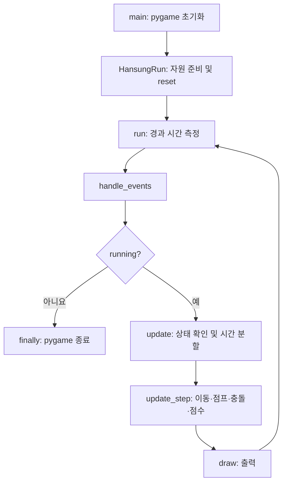

# 1. 한성런 기획 및 현재 구조

검토 기준: 2026-11-07, [prototype_game.py](prototype_game.py).

## 게임 목표

한성부기가 다가오는 장애물을 점프로 피하는 횡스크롤 러너다. 플레이어의 가로 위치는 고정되고 배경과 장애물이 왼쪽으로 이동한다. 장애물을 완전히 통과하면 10점을 얻고 충돌하면 게임오버가 된다. 시작 메뉴 없이 실행 즉시 시작한다.

`실행 → 달리기 → 점프·착지 → 통과(+10) → 다음 장애물 → 충돌 → 게임오버 → Enter 재시작`

## 현재 사양

| 항목 | 구현 |
| --- | --- |
| 화면 | 480×360, 출력 목표 120FPS |
| 시간 | 실제 경과 시간을 60Hz 기준 수치로 환산 |
| 플레이어 | x=0, 기준 이미지 높이 120, 지상 y=242 |
| 점프 | 초기 속도 -15, 중력 0.6의 60Hz 기준 수치, 공중 재점프 금지 |
| 배경·장애물 | 초당 360픽셀 이동, 배경 두 장으로 반복 |
| 장애물 | 한성캣·꼬꼬와 꾸꾸·상찌 중 균등 무작위로 한 개 등장 |
| 크기 | 앞의 두 종류 높이 120, 상찌 높이 40 |
| 재등장 | 이전 장애물이 왼쪽 밖으로 완전히 나가면 x=480에서 생성 |
| 점수 | 전체 장애물 사각형이 플레이어 왼쪽을 지나면 한 번만 10점 |
| 모션 | 2×2 시트의 4프레임, 행 순서, 프레임당 0.1초·주기 0.4초 |
| 최고점수 | 충돌 또는 종료 시 새 기록만 저장 |

장애물 종류의 연속 중복은 허용한다. 별도 등장 타이머가 없어 장애물 폭에 따라 재등장까지 시간이 달라진다. 점수가 올라도 난이도는 일정하다.

## 조작과 상태

| 입력 | 동작 |
| --- | --- |
| Space | 지상에서 점프 |
| Enter | 게임오버 후 재시작 |
| ESC | 일시정지·재개 |
| Ctrl+F4 / 창 닫기 | 기록 반영 후 종료 |

`running`, `game_over`, `paused`, `is_jumping`으로 상태를 관리한다. 게임오버와 일시정지는 동시에 참일 수 있다. 정지 중에는 점프·재시작을 무시한다. 점프 중에는 모션 시간을 멈추고 첫 포즈를 그리며 착지하면 이전 모션 시간에서 이어간다.

## 코드 구조

| 구성 | 책임 |
| --- | --- |
| 상단 상수 | 화면·물리·모션·충돌·자원 경로 설정 |
| `load_image()` | 코드 파일 기준 경로로 로딩, 비율 유지 크기 조절 |
| `load_run_frames()` | 4분할, 투명 여백 제거, 공통 배율과 발 기준 정렬 |
| `HansungRun.__init__()` | 화면·자원·폰트 준비, 기록 읽기, 초기화 |
| `reset()` | 위치·점수·모션·게임오버·정지 상태 초기화 |
| `spawn_obstacle()` | 종류 선택, 지면·충돌 보정, 재등장 좌표 설정 |
| `handle_events()` | 종료·정지·점프·재시작 처리 |
| `update(dt)` | 정지 여부 확인, 최대 0.1초 반영, 최대 1/60초 단위로 분할 |
| `update_step(step)` | 배경 → 모션 → 점프 → 장애물 → 충돌 → 점수 → 재등장 |
| `draw()` | 배경 → 장애물 → 플레이어 → 점수 → 게임오버 → 정지 안내 |
| `load_high_score()` | 기록 읽기, 파일이 없으면 0 |
| `record_high_score()` | 임시 파일에 쓰고 기록 파일 교체 |
| `stop()` | 기록 반영 후 실행 중단 |
| `run()` / `main()` | 시간 측정·실행 순서·pygame 초기화와 종료 정리 |

## 실행 흐름

## 데이터와 자원

- 공용 설정: 파일 상단 상수와 경로.
- 시작 시 자원: 배경, 기준 플레이어 이미지, 4프레임, 장애물 이미지, 폰트와 안내 표면. 매 프레임 다시 읽지 않는다.
- 한 판 상태: 좌표, 속도, 점수, 장애물 종류, 모션 시간, 점프·게임오버·정지 여부. `reset()`에서 초기화한다.
- 재시작 시 보존: 최고점수·저장 경로, 준비된 자원, 실행 여부.

| 파일 | 용도 |
| --- | --- |
| `image/sangsangbugi_run_4frames.png` | 현재 모션 |
| `image/sangsangbugi_side.png` | 플레이어 크기·정렬·충돌 사각형 기준 |
| `image/hansung_morning.png` | 현재 배경 |
| `image/hansungcat.png`, `image/ggoggoandgguggu.png`, `image/sangjji.png` | 장애물 |
| `high_score.txt` | 실행 간 보존되는 기록 |
| `test/test_game09.py` | 화면 없는 환경의 자동 검사 |

현재는 단일 파일 구성이 적절하다. 장면·동작·동시 장애물이 늘 때 책임별 클래스로 분리하는 방향은 [추가 문서](hansungrun_additions.md)에 정리했다.
