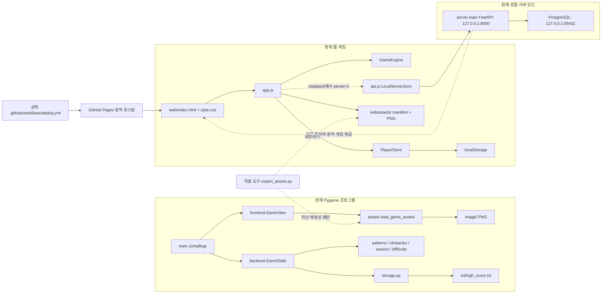
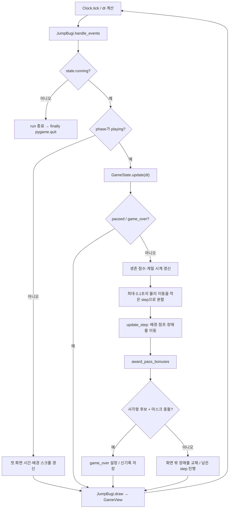
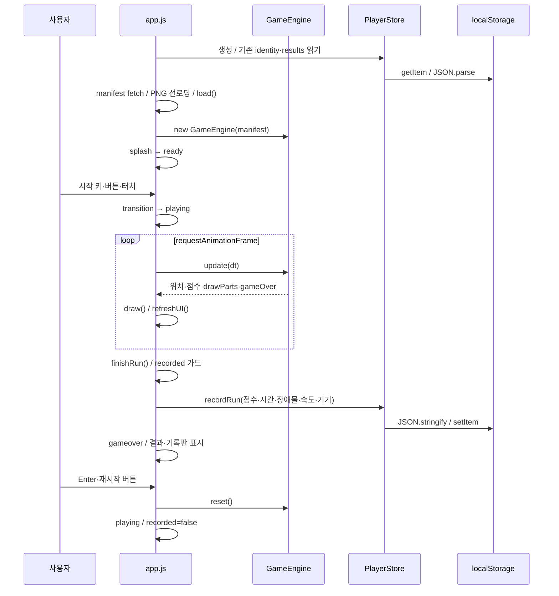
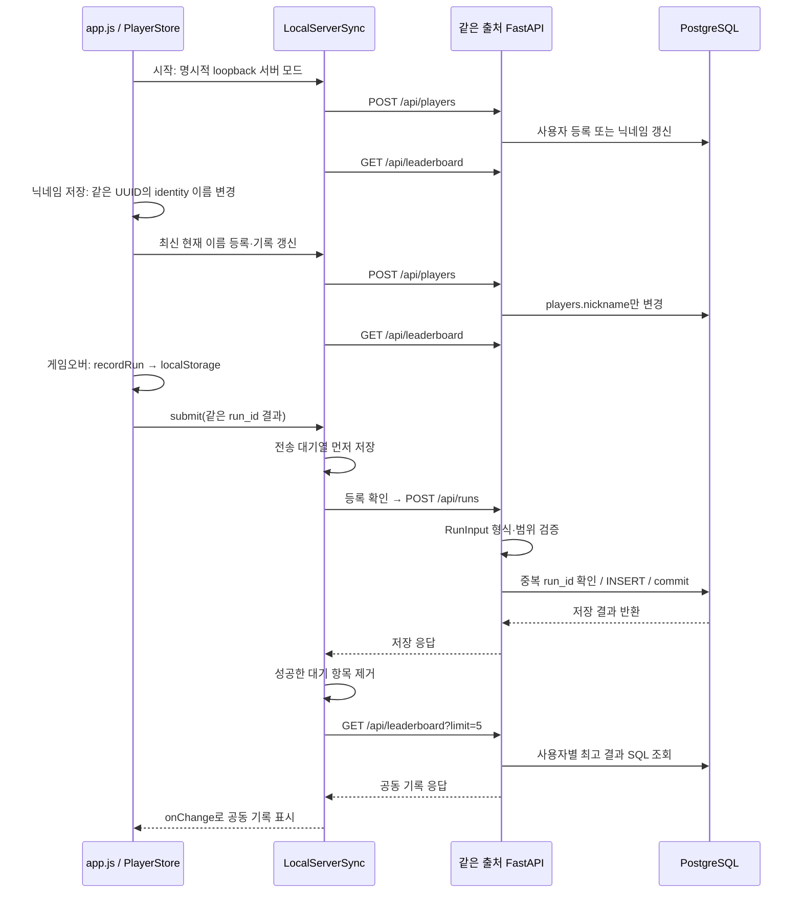

# 점프부기 현재 구조

## 전체 시스템과 문서 범위

확인 기준은 `desktop_prototype/`·`web/`·`server/`의 실제 소스와 테스트입니다. 두 게임은 실행·저장이 독립적입니다. 현재 Git 루트는 이 프로젝트 폴더의 상위이며 `.github/`·`study/`·저장소 README가 그곳에 있습니다. 아래 폴더 지도는 게임 프로젝트 `jumpbugi/` 기준입니다.



데스크톱 `backend.py`는 프로세스 안의 게임 규칙이고 `web/serve.py`는 개발용 정적 파일 서버입니다. 현재 `server/`의 FastAPI·PostgreSQL은 별도 로컬 실행에서 결과 저장·사용자별 최고 기록 조회를 제공합니다. Pages·정적 실행의 기본 브라우저 기록 모드와 구분하며, 계정 인증·점수 위변조 검증·클라우드 운영은 미구현입니다. [로컬 API와 PostgreSQL](#로컬-api와-postgresql)에서 실제 연결과 남은 범위를 설명합니다.

## 폴더 지도

```text
jumpbugi/
├─ README.md            실행 안내와 문서 목차
├─ AGENTS.md            AI 참조 범위와 자료 관리 기준
├─ desktop_prototype/   Pygame 데스크톱 프로토타입 소스
│  ├─ main.py           실행·입력·반복 순서
│  ├─ frontend.py       준비된 자원을 사용하는 화면과 UI
│  ├─ backend.py        GameState와 물리·충돌·득점 갱신 순서
│  ├─ patterns.py       해금된 패턴 풀·대기열·무작위 순서 선택
│  ├─ obstacles.py      장애물 점프 계획·포즈·상찌 무리 좌표
│  ├─ season.py         계절 슬롯·사이클·배경 전환값
│  ├─ difficulty.py     속도·접근 간격·패턴 난이도 확률
│  ├─ config.py         공통 설정과 내부 경로
│  ├─ assets.py         이미지·프레임·충돌 마스크와 GameAssets 조립
│  ├─ storage.py        최고점수 읽기·저장
│  └─ __init__.py       패키지 표시
├─ server/              로컬 FastAPI·PostgreSQL
│  ├─ main.py           요청 모델·API·DB 연결·정적 웹 제공
│  ├─ schema.sql        players/runs 테이블·제약·조회 인덱스
│  ├─ local.py          Windows 로컬 DB 준비·시작·API 실행·검사
│  ├─ requirements.txt  서버·검사 의존성
│  ├─ tests/            실제 PostgreSQL API 통합 검사
│  └─ README.md         로컬 실행·저장 범위 안내
├─ docs/
│  ├─ TODO.md
│  ├─ CHANGELOG.md
│  ├─ ARCHITECTURE.md
│  ├─ BACKEND.md         로컬 서버 실행·중단·재개·검증 절차
│  ├─ WEB_REVIEW.md      웹 이식 상태와 점검 기록
│  ├─ WEB_STUDY.md       웹 입문·코드 구조·실습 학습 문서
│  ├─ LEARNING_ROADMAP.md 기술별 선행 지식·실습·완료 기준
│  ├─ prompts/          실제 요청 색인·재사용 양식
│  ├─ DIFFICULTY_REPORT.json 자동 회피·연속 플레이 결과
│  ├─ STUDY_NOTES.md
│  ├─ GAME_IDEA.md
│  └─ archive/          이전 문서·배경 작업 자료
├─ image/               실행 그림·계절 배경·원본·미리보기
├─ tools/
│  ├─ verify_difficulty.py 실제 이미지의 계획별 회피·연속 플레이 검증
│  └─ verify_local_backend.mjs 실제 Chrome·Edge와 로컬 API 저장 검사
├─ web/                 독립 브라우저 게임·자산·Node 검사
├─ txt/
│  ├─ README.md         점수 데이터와 문서 안내
│  └─ high_score.txt    실제 기록
└─ tests/
   ├─ __init__.py
   ├─ test_game.py
   ├─ test_collision.py
   ├─ test_obstacle_patterns.py
   ├─ test_hsucat_obstacles.py
   ├─ test_giant_hsucat.py
   ├─ test_book_hsucat.py
   ├─ test_running_hsucat.py
   ├─ test_flying_levels.py
   ├─ test_sj_obstacles.py
   ├─ test_sj_holes.py
   ├─ test_sj_jumping.py
   ├─ test_greeting_jumps.py
   ├─ test_scoring_speed.py
   ├─ test_underpass_scoring.py
   ├─ test_difficulty.py
   ├─ test_verifier.py
   ├─ test_seasons.py
   └─ test_startup.py
```

`__pycache__`는 파이썬이 만드는 캐시입니다. Pygame 소스는 `desktop_prototype/`, 실행 자산·실제 점수·테스트·도구는 `jumpbugi/` 루트 아래의 기존 폴더에 둡니다. 프로젝트를 옮길 때 이 구성을 함께 보관합니다.

이 문서는 **HansungRun Pygame Prototype 1.0**과 `web/` 이식본의 현재 구조를 설명합니다. 480×360 Pygame 기준본은 라즈베리파이 이식과 규칙 참고용으로 유지하며, 웹은 640×360의 독립 JavaScript 게임으로 구현했습니다. 아래 Pygame 구조와 [웹 이식본 구조](#웹-이식본-구조)를 구분해 읽습니다. Python 학습 개념은 [STUDY_NOTES](STUDY_NOTES.md), 웹 학습은 [WEB_STUDY](WEB_STUDY.md), 전체 학습 순서는 [LEARNING_ROADMAP](LEARNING_ROADMAP.md), 기획은 [GAME_IDEA](GAME_IDEA.md), 다음 작업은 [TODO](TODO.md), 완료 기록은 [CHANGELOG](CHANGELOG.md)에 둡니다. 프롬프트 출처와 재사용 양식은 [prompts](prompts/README.md)에서 관리합니다.

## Pygame 역할과 연결

이 절의 짧은 Python 파일명과 모듈명은 모두 `desktop_prototype/` 안을 가리킵니다. 2026-11-22 정리는 파일 위치와 참조 경로만 변경했으며 함수·클래스·게임 규칙과 기능별 분리를 유지합니다.

```text
main → frontend → assets
main → backend → patterns / obstacles / season / difficulty / storage
difficulty → season (SeasonProgress의 기존 import 경로 유지)
patterns / obstacles / season / difficulty / assets → config
main / frontend / backend → config
tests → 게임 동작 확인
```

메인·프론트·백은 같은 프로그램입니다. 백은 인터넷 서버가 아니라 게임 규칙 담당입니다. `JumpBugi`가 화면 담당 `GameView`와 상태 담당 `GameState`를 보유합니다.

`GameView`는 화면을 만든 뒤 `assets.load_game_assets()`로 `GameAssets`를 한 번 전달받습니다. 메인은 이 자원의 이미지 크기·모션 수·배경 너비·프레임별 플레이어 마스크·종류별 장애물 마스크를 백에 전달합니다. 백은 위치와 마스크 겹침으로 충돌을 계산하며 화면을 만들거나 이미지를 읽지 않습니다. 프론트는 백의 상태와 공통 `player_frame_index`를 사용해 같은 프레임을 그립니다.

`patterns.py`는 `PatternUnlocks`로 허용 유형을 판단하고, `available_patterns()`·`unlocked_queue()`·`choose_pattern()`으로 패턴 풀과 잠긴 대기열 정리·확률 선택을 담당합니다. `obstacles.py`는 `GreetingJump`·`SjMember`, 인사·달리는 한성캣·상찌의 점프 계획 생성, `frame_index()`와 `cluster_parts()`를 담당합니다. `season.py`는 `SeasonProgress`와 `BackgroundTransition`·`background_transition()`으로 진행 상태와 배경 혼합값을 계산합니다. 세 모듈은 Pygame·화면·저장과 독립적이며 `GameState`를 import하지 않습니다.

`difficulty.py`는 `DifficultyProfile`과 속도·간격·패턴 확률을 담당하며, 기존 `difficulty.SeasonProgress` import도 유지합니다. `backend.GameState`는 기존 공개 속성·메서드를 유지한 채 위 계산 함수에 값을 전달합니다. `backend.GreetingJump`·`backend.SjMember` 경로도 같은 클래스에 연결합니다. config는 조절 가능한 수치와 공통 기준표이며 storage는 파일을 읽고 임시 파일 교체 방식으로 기록합니다.

`assets.py`는 그림 읽기·크기 조절·모션 시트 분리·합성·마스크 생성과 `GameAssets` 조립에 집중하고, `frontend.py`는 배경 사본·글꼴·UI·렌더링에 집중합니다. 캐릭터별 시트 처리 함수는 동일한 자원 준비 흐름을 공유하므로 파일 길이만을 이유로 더 나누지 않았습니다. 플레이어 적분·충돌·득점은 짧은 상태 갱신이며 순서가 동작에 영향을 주므로 `backend.GameState`에 함께 유지합니다. 별도 `player.py`·`scoring.py`·`game_state.py`로 옮기기 위한 전달용 계층은 추가하지 않았습니다.

의존성은 위에서 아래 방향이며 계산 모듈에서 backend·frontend를 다시 import하지 않습니다. 루트에서는 `python -B -m desktop_prototype.main` 또는 `python -B desktop_prototype/main.py`, 상위 `pygame/`에서는 `python -B -m jumpbugi.desktop_prototype.main`으로 실행합니다. 기존 모듈 간 의존성을 유지합니다.

| 수정하려는 기능 | 확인할 파일 |
| --- | --- |
| 점프 물리·충돌·득점 | `backend.py` + `config.py` |
| 계절·낮밤 슬롯·배경 전환 | `season.py` + `config.py` |
| 난이도 곡선·접근 간격·어려운 패턴 확률 | `difficulty.py` + `config.py` |
| 패턴 풀·해금 필터·대기열 선택 | `patterns.py` + `config.py` |
| 장애물 점프 궤적·애니메이션 포즈·상찌 무리 좌표 | `obstacles.py` + `config.py` |
| 장애물 추가·생성 상태 연결 | `backend.py` + `patterns.py` + `assets.py` + `config.py` |
| 이미지·애니메이션 프레임·마스크 준비 | `assets.py` |
| 인트로·UI·입력 흐름 | `frontend.py` + `main.py` |
| 최고점수 저장 | `storage.py` |

## 실행 순서

`main() → pygame 초기화 → JumpBugi 생성 → run() → 종료 시 pygame 정리`

`JumpBugi.phase`는 첫 실행의 `splash → ready → transition → playing` 순서를 관리합니다. `splash`에서는 사용자가 제공한 `image/intro.png`를 `SPLASH_SECONDS=2.0`초 동안 표시하고 일반 키 입력을 무시합니다. `config.START_IMAGE_FILE`이 이 파일을 가리키며 그림에 제목이 포함돼 있어 별도 제목·말풍선 오버레이를 만들거나 겹치지 않습니다. 이전 시작 그림 `start.png`·`start.jpg`는 `image/이미지자료/`에 보존합니다. `ready`에서는 흰 배경에서 별도의 `intro_elapsed`로 상상부기 달리기를 갱신하고 시작·조작 안내만 표시합니다. 아무 키나 누르면 `reset()`을 호출하지 않고 `transition`으로 넘어가므로 부기의 위치와 달리기 시계가 이어집니다.

시작 이미지는 `assets.intro_content_rect()`로 알파가 224 이상이면서 흰색과의 채널 차이가 32 이상인 픽셀의 경계를 찾아 희미한 외곽 여백을 제외합니다. `assets.prepare_intro_cover()`는 이 경계의 긴 변을 기준으로 4%의 안전 여백을 더하고 원본 범위 안으로 제한합니다. 이어 `scale = max(화면 너비 / 준비 영역 너비, 화면 높이 / 준비 영역 높이)`로 한 배율을 구해 종횡비를 유지한 크기로 조절합니다. 소수 출력 크기는 올림하고, 넘치는 부분을 중앙에서 잘라 최종 480×360의 불투명 표면을 만듭니다. 이전의 12픽셀 가장자리 투명 처리와 작은 이미지 배치는 사용하지 않습니다.

콘텐츠 경계와 중앙 crop은 현재 `intro.png`에서 계산하므로 이미지에 포함된 제목도 캐릭터·소품과 함께 준비 영역에 반영합니다. 원본 파일은 수정하지 않고 시작 시 표시용 표면만 한 번 준비해 재사용합니다. `GameView.draw_startup()`은 `splash`에서 이 표면만 `(0, 0)`에 그립니다. `GAME_TITLE`은 창 제목에 사용하며 시작 그림 위에 별도 글자로 렌더링하지 않습니다.

`transition`은 시작 키를 누른 뒤 배경을 드러내는 인트로 달리기 단계입니다. 이때 `GameState.scroll_background(dt)`로 `background_x`를 정상 게임과 같은 속도로 갱신합니다. 이 메서드는 배경 위치만 이동하며 일반 플레이의 `update_step()`에서도 함께 사용합니다. 시작 속도는 초당 `BACKGROUND_SPEED × PHYSICS_HZ`이며 실제 값은 현재 설정을 따릅니다. 전환에서도 긴 프레임의 이동량은 일반 플레이와 같이 최대 0.1초로 제한하고, 페이드 진행률은 실제 경과 시간으로 계산합니다.

`transition_elapsed`로 `START_FADE_SECONDS=1.25`초의 전환 진행률을 계산합니다. `GameView.draw_startup()`은 흰 배경을 채운 뒤 `background_x`와 `background_x + background_width`에 한성대 봄 낮 배경을 이어 그립니다. 배경 알파만 0에서 255로 부드럽게 높여 이미 스크롤 중인 풍경을 드러내고 시작·조작 안내를 사라지게 합니다. 부기는 항상 그 위에 원래 알파로 그려 계속 달립니다. 전환이 끝나도 `reset()`을 호출하지 않아 스크롤 위치가 그대로 이어지고, 인트로의 달리기 시간을 `GameState.animation_tick`으로 넘겨 첫 플레이 프레임에서도 자세가 끊기지 않게 합니다.

세 시작 단계에서는 `GameState`의 점수·계절·장애물·점프가 진행되지 않습니다. 배경의 가로 위치는 `transition`에서만 먼저 진행하며, 계절 시계인 `background_elapsed`는 플레이 시작까지 0으로 유지합니다. 전환 중 추가 키와 시작 키의 입력 묶음은 무시하며, QUIT와 Ctrl+F4는 모든 단계에서 종료합니다. 배경 전환이 완료되면 `playing`으로 넘어가고 다음 갱신부터 장애물이 화면으로 들어옵니다. 게임오버 후 Enter로 호출하는 `reset()`은 바로 `playing`으로 전환하므로 첫 실행 연출을 반복하지 않습니다. 시작 이미지는 `load_game_assets()`가 한 번 준비하고, `GameView`는 전달받은 이미지와 직접 만든 안내 글자를 재사용합니다.

run은 경과 시간 확인 → 입력 처리 → 백 갱신 → 화면 출력 순서로 반복합니다. `game_over`는 이번 판의 종료, `running=False`는 실행 반복 자체의 종료입니다. 정지·게임오버 동안 일반 갱신은 멈춥니다.

### 한 프레임에서 호출하는 함수



그림의 `Step`은 60Hz 수치 기준 시간 비율입니다. 실제 코드는 `remaining=min(dt, 0.1)*PHYSICS_HZ`, `step=min(remaining, 1/speed_multiplier)`로 반복합니다. 생존·계절 시계는 제한 전의 양수 `dt`를 사용합니다. QUIT·Ctrl+F4는 `GameState.stop()`에서 신기록을 반영하고 반복을 끝냅니다. 게임오버의 Enter는 `reset()`으로 한 판 상태를 초기화하며 프로그램 초기화·자산 로딩은 반복하지 않습니다.

## 경로 기준

`desktop_prototype/config.py`의 `PROJECT_DIR = Path(__file__).resolve().parent.parent`입니다. 소스 폴더의 상위인 `jumpbugi/` 루트가 기준이며 터미널의 현재 위치와 무관합니다.

- 이미지: `PROJECT_DIR / 'image'`
- 최고점수: `PROJECT_DIR / 'txt' / 'high_score.txt'`
- 프로젝트를 다른 곳으로 옮길 때도 이 폴더들을 함께 옮깁니다.

`tests/`와 `tools/verify_difficulty.py`는 `desktop_prototype` 패키지를 import합니다. 웹 자산 내보내기는 `desktop_prototype/assets.py`·`config.py`를 사용하고, 원본 보존용 소스 해시도 `desktop_prototype/*.py`를 대상으로 확인합니다. 웹 실행 자체는 이 Python 소스를 호출하지 않습니다.

## 현재 사양과 저장

480×360, 출력 목표 120FPS, 물리 수치 기준 60Hz입니다. 점프 속도 -15, 중력은 `GRAVITY` 설정, 통과 보너스는 한 장애물 단위당 10점이며 상찌 무리는 마리당 10점입니다. 기존 장애물, 흰색·갈색 캐릭터의 지상·비행형, 추가 한성캣, 상찌의 달리기·굴 파기·두 마리·세 마리 묶음을 무작위 순차 패턴으로 사용합니다. 상상부기의 달리기는 네 프레임이며 계절별 낮·밤 8장이 `DAY_NIGHT_INTERVAL` 간격에 4초 혼합으로 순환합니다.

생존 점수는 `survival_elapsed`의 온전한 1초마다 1점씩 더합니다. 통과 보너스와 합산하며 정지·게임오버 때는 갱신하지 않습니다. 시간은 실제 전달된 양수 dt를 누적하고, 기존과 같이 물리 이동만 0.1초로 제한합니다. 충돌이 발견된 갱신까지의 생존 점수가 최고점수에 반영됩니다.

`award_pass_bonuses(player_left)`는 높이나 플레이어의 점프 입력 여부와 관계없이 수평 위치로 통과 보너스를 판정합니다. 상찌 무리는 각 멤버의 정수 화면 x좌표에 한 마리 너비를 더한 오른쪽 끝이 플레이어 왼쪽을 지났을 때 10점씩 주고 멤버의 `passed`를 기록합니다. 두 마리는 20점·세 마리는 30점이며, 먼저 지난 상찌의 점수는 남은 멤버와 충돌하기 전에 반영해 최고점수에 포함합니다. 모든 멤버가 통과해야 무리 전체의 `passed`가 참이 되고, 다음 무리 생성·재시작 때 멤버별 기록을 초기화합니다. 다른 단일 장애물과 비행형·인사 캐릭터의 아래 통과도 기존처럼 한 단위당 10점을 한 번 받습니다.

단일 장애물의 통과 조건은 `int(obstacle_x) + obstacle_width <= player_left`입니다. `is_jumping`, `obstacle_requires_jump`, `wave_jump`, 비행 높이나 애니메이션 포즈를 득점 조건에 사용하지 않습니다. 따라서 달리기·넘어짐·하품·책·굴 파기·높은 점프·세 비행 높이 모두 같은 경로로 10점을 받습니다. 생존 점수는 별도로 합산하며, 기본 꾸꾸·꼬꼬 그림은 기존처럼 한 논리 장애물입니다.

속도 배율은 `difficulty.speed_multiplier_for_slot()`에서 누적 슬롯을 기준으로 계산합니다. 슬롯 경계에서 즉시 적용하며 배경 혼합 완료까지 기다리지 않습니다. 배경·장애물에 같은 배율을 사용하고 점프 물리는 유지합니다. 기본 속도는 60Hz당 `BACKGROUND_SPEED`·`OBSTACLE_SPEED` 픽셀입니다. 가속 후에도 충돌 검사 사이의 장애물 이동량은 기본 `OBSTACLE_SPEED` 이하가 되도록 세부 단계를 나눕니다. 재시작하면 생존 시간·계절 시계·진행 단계가 0으로 돌아갑니다.

신기록은 게임오버 또는 종료 요청 시 저장합니다. 기록이 없으면 0으로 시작하지만 숫자가 아닌 내용이나 음수 기록을 자동 복구하지는 않습니다.

점수 조절 지점은 `config.PASS_BONUS`와 `config.SURVIVAL_POINTS_PER_SECOND`입니다. 예를 들어 생존 35초에 단일 장애물 4개를 통과하면 `35 + 4 × 10 = 75`점입니다. 상찌 무리는 장애물 단위 수 대신 통과한 마리 수로 보너스를 계산합니다.

### 데이터의 생성·전달·저장

| 데이터 | 생성·소유 | 전달·처리 | 저장 범위 |
| --- | --- | --- | --- |
| PNG·프레임·마스크 | `assets.load_game_assets()`의 `GameAssets` | `GameView`가 보유하고 `JumpBugi`가 크기·마스크를 `GameState`에 전달 | 실행 중 재사용. 원본 이미지 수정 없음 |
| 입력·프레임 시간 | Pygame 이벤트·`Clock.tick()` | `handle_events()`와 `update(dt)` → 상태 변경 | 입력 이력의 영속 저장 없음 |
| 플레이 위치·계절·난이도 | `GameState`, 계산 모듈의 반환값 | 상태를 `GameView.draw()`가 읽어 출력 | 실행 중 메모리 |
| 생존·통과 점수 | `GameState.update()`·`award_pass_bonuses()` | 충돌/종료 → `record_high_score()` | 최고값 하나만 `txt/high_score.txt` |
| 웹 자산·마스크 | 개발 시 exporter가 생성한 manifest·PNG | `load()` → `GameEngine`·렌더러가 같은 프레임/마스크 사용 | 웹 배포 파일. 실행 때 Python 호출 없음 |
| 웹 플레이 결과 | `finishRun()`의 엔진 상태 요약 | `PlayerStore.recordRun()` → JSON 직렬화 | 접속 origin의 `localStorage` 또는 이번 접속 메모리 |
| 서버 전송 대기 | 서버 모드의 `LocalServerSync.submit()` | 같은 run_id 대기열 → 등록/POST → 성공 후 제거 | `jumpbugi.web.v1.pending` 또는 접속 메모리 |
| 로컬 서버 결과 | `RunInput`으로 검증한 종료 요약 | 요청별 SQL 트랜잭션 → 사용자별 최고 결과 조회 | PostgreSQL `players`·`runs`, 실제 데이터는 로컬 APPDATA |

Pygame 저장은 `load_high_score()`가 기존 값을 읽고 `save_high_score()`가 같은 디렉터리의 `.tmp` 파일을 교체합니다. 웹 결과는 점수·생존시간·사망 장애물·최대 속도·기기 구분과 ID·게임 버전·시각을 포함합니다. 서버 모드도 이 요약을 저장하며 실제 입력 이력·재연산 근거를 수집하지 않습니다. 형식 검증을 통과했다는 사실만으로 점수의 진위를 보장하지 않습니다.

## 장애물 유형과 패턴

패턴의 후보·잠금 필터·대기열 선택은 `patterns.py`, 점프 계획과 애니메이션 포즈 계산은 `obstacles.py`에서 찾습니다. `GameState.spawn_obstacle()`는 선택한 결과를 현재 장애물 상태에 반영하며 기존 생성·무작위 선택 순서를 유지합니다.

`OBSTACLE_FILES`는 기본 한성냥이·꾸꾸꼬꼬·상찌의 논리 이름 3개입니다. `config.WAVE_IMAGE_FILES`는 `hsucat.png`를 `hsucat_wave.png`, `chicken.png`를 `chicken_wave.png`로 연결하고, `SJ_BASE_IMAGE_FILE='sj_wave.png'`는 기본 상찌의 실제 시트를 정합니다. 이전 정지 PNG는 보존하며 기본 세 종류의 실제 표시는 인사 시트로 준비합니다. `CHICKEN_TYPES`는 추가된 흰색·갈색 지상형과 비행형 4개입니다. `assets.load_chicken_frames`는 `chicken_flap.png`의 2행×4열을 캐릭터별로 분리하고 동일한 크기·발 위치로 정렬합니다. 시트는 시작 시 한 번 읽으며 지상형은 높이 96, 비행형은 80입니다.

`assets.load_greeting_frames(filename, height)`는 2×2 인사 시트의 네 포즈를 공통 배율로 준비하고 양발 중심과 발바닥 높이를 맞춥니다. 기본 꾸꾸·꼬꼬는 흰색·갈색 두 캐릭터를 합친 146×120, 한성냥이는 85×120이며, 지상 발끝은 `WAVE_GROUND_OFFSET=-2`로 y=358에 맞춥니다. 상찌 로더도 같은 정렬 처리를 사용해 기존 42×40을 유지합니다.

기본 두 인사 종류는 `WAVE_JUMP_UNLOCK_SLOT=8`, 즉 8단계 이후 생성될 때부터 점프를 선택합니다. 최초 사계절 동안은 지상 인사만 하며 플레이어가 뛰어넘습니다. 점프 여부는 생성 시 65% 확률로 한 번 결정하므로, 8단계 전에 나온 장애물이 접근 중에 갑자기 뛰지는 않습니다. 재시작하면 8단계 조건과 점프 계획을 초기화합니다.

8단계 이후의 계획은 높은 점프(`high`, 192픽셀), 머리 위 점프(`near`, 128픽셀), 낮은 점프(`low`, 12픽셀)의 세 종류입니다. `high`와 `near`는 점프하지 않고 아래로 통과하고, `low`와 점프하지 않는 지상 인사는 플레이어가 뛰어넘습니다. 공중에는 `obstacle_frame_index=0`을 고정하고 지상에서 네 인사 포즈를 재생합니다. `wave_jump`의 계획과 `wave_jump_active` 상태를 사용하며, 검증 봇의 `obstacle_requires_jump`도 같은 회피 구분을 따릅니다.

점프 선택 확률·높이는 `config.WAVE_JUMP_PROBABILITY`와 `config.WAVE_JUMP_HEIGHTS`, 해금 슬롯은 `config.WAVE_JUMP_UNLOCK_SLOT`에서 조절합니다.

궤적은 시간 대신 수평 이동 거리의 진행률로 계산합니다. 수평 접촉 구간 중심 `center=(player_width-obstacle_width)/2`와 반폭 `contact_half=(player_width+obstacle_width)/2`를 구한 뒤, 패턴별 여유 비율과 생성 시 속도·최소 비행 시간을 반영해 `flight_half`를 정합니다. `p=(center+flight_half-obstacle_x)/(2×flight_half)`의 0~1 구간에서 y 오프셋을 `-4×height×p×(1-p)`로 계산합니다. 높은 점프와 머리 위 점프는 전체 수평 접촉 구간에 머리 여유가 남도록 하므로, 가속이나 FPS 변화에도 아래 통과가 가능합니다. 그리기와 마스크 충돌은 이 y좌표와 고정 포즈를 함께 사용합니다.

계획 데이터는 `obstacles.GreetingJump(pattern, height, center_x, half_distance)`에 보관하고 `progress(x)`·`is_jumping(x)`·`y_offset(x)`로 현재 상태를 계산합니다. 기본 가로 여유 비율은 높은 점프·낮은 점프가 2.2, 머리 위 점프가 4.8이며, 생성 속도에서 최소 0.9초에 해당하는 가로 범위도 확보합니다. 아래 통과 패턴에는 `WAVE_UNDERPASS_CLEARANCE=4` 기준을 반영해 높이와 여유 비율의 최솟값을 보정합니다. 거리에 따라 궤적을 계산하므로 실제 비행 시간은 이동 속도에 따라 달라집니다.

`HSUCAT_TYPES`는 `hsucat_run.png`, `hsucat_crouch.png`, `hsucat_book.png`입니다. 달리기는 2×2 시트의 네 포즈를 공통 배율과 발 위치로 정렬합니다. 책 한성캣의 `hsucat_book.png`는 논리 이름으로 유지하며 실제로는 `HSUCAT_BOOK_IMAGE_FILE='hsucat_drop_book.png'`의 네 포즈를 180×120 크기로 준비합니다. 거대 한성캣의 `hsucat_crouch.png`도 기존 패턴의 논리 이름으로 유지하며, 실제 표시는 `HSUCAT_GIANT_IMAGE_FILE='hsucat_yawn.png'` 한 장으로 교체합니다. 원본 PNG는 수정하지 않습니다.

`assets.load_hsucat_run_obstacle_frames(height)`는 기존 90×120 달리기 네 포즈의 픽셀과 x좌표를 유지하고 오른쪽에 투명 여백을 더한 뒤, `hsucat_fall.png`의 네 넘어지기 포즈를 이어 준비합니다. 넘어지기는 한 배율로 비율을 유지하며 왼쪽과 발바닥을 정렬해 몸이 낮아지고 오른쪽으로 펼쳐집니다. 여덟 표면과 마스크는 같은 122×120 크기로 캐시합니다. `HSUCAT_RUN_GROUND_OFFSET=-2`로 하단을 y=358에 맞춰 달리기와 넘어진 자세의 발이 화면 아래로 잘리지 않게 합니다.

`hsucat_run_mode`는 생성할 때 `HSUCAT_RUN_MODES=('fall', 'high', 'low', 'run')` 중 허용된 동작을 같은 확률로 한 번 선택합니다. 첫 가을 4슬롯부터는 넘어지기·달리기만 허용하고, 두 점프는 다른 점프 장애물과 같이 8슬롯부터 허용합니다. 일반 달리기는 앞의 네 포즈만 순환합니다. 넘어지기는 x=420까지 달린 뒤 `HSUCAT_FALL_START_X=420`에서 `HSUCAT_FALL_END_X=180`까지 뒷 네 포즈를 위치에 따라 진행하고 마지막 포즈를 유지합니다. 두 점프는 기존 `GreetingJump`의 거리 기반 포물선을 사용하며 `HSUCAT_RUN_JUMP_HEIGHTS`의 높은 점프 384픽셀·낮은 점프 24픽셀을 사용합니다. 비행 범위는 접촉 반폭 2.2배와 생성 속도에서 최소 0.9초에 해당하는 거리 중 큰 값입니다. 높은 점프는 서 있는 플레이어 위의 여유를 보정하며 정점에서 발끝까지 화면 위로 사라집니다. 낮은 점프는 플레이어가 뛰어넘습니다. 공중 포즈는 0을 고정하고 착지하면 기존 달리기 네 포즈를 재개합니다.

높은 점프와 낮은 점프를 포함한 모든 점프 동작은 누적 8슬롯부터 허용합니다. 8슬롯 전에 선택한 지상 동작은 접근 중에 바뀌지 않습니다. `wave_jump`를 사용하는 높은 점프는 `obstacle_requires_jump=False`, 낮은 점프·달리기·넘어지기는 `True`입니다. 기존 수평 통과 판정이 점프 입력과 높이에 관계없이 10점을 한 번 주므로 아래 통과도 같은 보너스를 받습니다. 정지·게임오버에서는 위치·포즈·궤적이 멈추고 새 등장·재시작 때 동작과 진행을 새로 만듭니다.

`assets.load_hsucat_book_frames(height)`는 책 떨어뜨리기 시트의 네 칸에서 알파 20 경계를 합친 공통 원본 영역 `(96, 27, 591, 451)`을 사용합니다. 각 포즈를 따로 가운데 정렬하지 않아 책이 옆으로 퍼져도 캐릭터의 좌표를 유지합니다. 기존 180×120 이미지의 실제 콘텐츠 경계 `(12, 11, 154, 102)` 안에 공통 비율로 맞추고 발 기준점 `(89, 113)`에 배치합니다. 이전 PNG는 배치 기준으로만 읽고 화면에는 새 네 포즈를 표시하며, 이미지와 마스크를 한 번 준비해 재사용합니다.

책 떨어뜨리기의 진행은 애니메이션 시간 대신 접근 위치를 사용합니다. `HSUCAT_BOOK_DROP_DISTANCE=300`에 따라 x=480에서 180까지 `progress=clamp((480-x)/300, 0, 1)`을 계산하고 `int(progress × 3)`번째 포즈를 출력·충돌에 함께 사용합니다. 화면 밖에서 동작이 끝나지 않도록 화면 진입부터 진행하고, x=180 이후에는 마지막 포즈를 유지합니다. 정지·게임오버에서는 위치와 포즈가 함께 멈추며 새 등장·재시작 때 첫 포즈로 돌아갑니다. 해금·점프 회피·10점 보너스는 유지합니다.

`assets.load_hsucat_giant_frames(size)`는 새 하품 시트 한 장을 2행×2열로 나눠 알파 20 이상의 콘텐츠 경계로 투명 여백을 제외합니다. 기존 `HSUCAT_GIANT_SIZE=(202, 120)`와 이전 캐릭터의 콘텐츠 경계 `(16, 14, 167, 98)`를 기준으로 네 포즈에 한 배율을 적용하고 가로 중심·발바닥을 맞춥니다. `hsucat_sleepy.png`는 로딩하지 않으며, 화면과 충돌에 사용할 네 포즈와 마스크만 한 번 준비해 재사용합니다.

거대 한성캣의 진행은 위치 기반입니다. `HSUCAT_GIANT_YAWN_START_X=480`에서 `HSUCAT_GIANT_YAWN_END_X=140`까지 `progress=clamp((480-x)/(480-140), 0, 1)`을 계산하고 `int(progress × 3)`번째 포즈를 출력·충돌에 함께 사용합니다. 진행 구간은 기존 260픽셀에서 340픽셀로 약 31% 길어져 같은 이동 속도에서 천천히 하품합니다. 0→1→2→3으로 한 번 진행한 뒤 x≤140에서는 입을 크게 벌린 마지막 3번 자세를 유지합니다. 화면 밖에서 하품이 끝나지 않고, 시간이 길어져도 처음으로 돌아가지 않습니다. 두 이미지 선택·교대 상태는 제거했습니다. 정지·게임오버에서는 위치와 포즈가 멈추며 새 등장·재시작 때 첫 포즈로 돌아갑니다. 해금 단계·지상 위치·회피와 통과 10점은 유지합니다.

`SJ_TYPES`는 `sj_run.png`, `sj_burrow`, `sj_escape`, `sj_pair`, `sj_triple`입니다. 달리기는 43×40 두 포즈, 굴 진입은 기존 땅 파기·구멍 시트로 합성한 112×64의 12포즈, 탈출은 `sj_escape.png`의 2×2 시트를 공통 배율과 바닥 위치로 맞춘 112×64 네 포즈를 사용합니다. 진입 완료 후에는 빈 구덩이를 유지하고 탈출 완료 후에는 몸이 나온 마지막 자세를 유지합니다.

`sj_hole_timing`은 생성할 때 빠름·느림 중 하나를 같은 확률로 선택하고 진행 중에는 바뀌지 않습니다. `SJ_BURROW_PROFILES`는 빠름 (480, 330)·느림 (480, 170), `SJ_ESCAPE_PROFILES`는 빠름 (480, 300)·느림 (480, 180)의 시작·완료 x좌표입니다. 완료 위치는 최소 `player_width + SJ_HOLE_CLEARANCE(32)`로 보정합니다. `sj_hole_progress=clamp((start_x-x)/(start_x-end_x), 0, 1)`에 따라 포즈를 진행하므로 FPS와 가속 중에도 몸체가 플레이어와 만나기 전에 진입·탈출이 완료됩니다. 같은 속도에서 느림은 빠름보다 오래 걸리며 실제 초 단위 시간은 이동 속도를 따릅니다.

`load_sj_obstacles(..., collision_frames=...)`는 표시 프레임과 별도로 몸체 전용 충돌 표면을 전달합니다. 진입은 같은 클립과 가라앉는 위치로 몸체만 합성하며, 마지막 표면은 비어 있습니다. 탈출은 축소된 그림의 초록 몸체·연노란 배 영역과 연결 외곽을 채워 몸체를 잡고 주황 구덩이를 제외합니다. `load_game_assets()`가 이 표면으로 마스크를 한 번 준비하므로 빈 구덩이는 통과해도 충돌하지 않습니다. 배·머리 등 나온 몸체는 실제로 충돌합니다. 진입은 `obstacle_requires_jump=False`, 탈출은 `True`이며 둘 다 통과 10점은 공통 경로로 계산합니다.

`sj_escape_enabled`는 `SJ_ESCAPE_UNLOCK_SLOT=8`을 따릅니다. 첫 사계절 이전에는 탈출이 후보와 대기열 모두에서 제외되고 다음 봄부터 등장합니다. 기존 진입·달리기는 첫 겨울 6단계 해금을 유지합니다. 정지·게임오버에서는 위치와 진행이 멈추고 새 등장·재시작 때 속도 계획을 새로 만듭니다.

기본 상찌는 `assets.load_sj_wave_frames()`로 `sj_wave.png`의 2×2 시트를 네 포즈로 나눠 준비합니다. 팔의 너비가 달라도 몸통이 흔들리지 않도록 양발 영역의 중심과 발바닥 높이를 맞춘 42×40 프레임을 사용합니다. 첫 사계절이 끝난 8단계 이후 자동 생성에서 기본 상찌가 선택되면 두 마리 또는 세 마리 묶음으로 무작위 변환합니다. 마리 사이 3픽셀을 두어 두 마리의 크기는 87×40, 세 마리는 132×40입니다. `load_sj_obstacles(..., reference_frames=...)`는 지상 묶음의 손 흔들기 프레임도 준비합니다. 이전 `sj.png`를 포함한 원본 PNG는 수정하지 않습니다.

상찌의 달리기·굴 파기 해금은 `SJ_UNLOCK_SLOT=6`으로 유지하며, 무리 출현은 `SJ_GROUP_UNLOCK_SLOT=8`, 랜덤 점프는 `SJ_JUMP_UNLOCK_SLOT=8`으로 따로 관리합니다. 잠긴 무리는 패턴 후보와 대기열에서 제외하고 기본 상찌의 무리 변환도 8단계부터 허용합니다. 기본 한 마리 상찌와 `sj_run.png`는 8단계 이후 생성 시 낮은 점프·높은 점프·지상 유지 중 하나를 선택하고, 구덩이 진입·탈출은 별도의 빠름·느림 계획을 사용합니다.

무리의 `SjMember`마다 65% 확률로 점프를 선택하며, 점프할 때는 높은 점프와 낮은 점프를 같은 확률로 고릅니다. 낮은 점프의 최고 상승량은 18픽셀이고 높은 점프는 306픽셀입니다. 시간 대신 수평 위치에 따른 공통 `GreetingJump` 포물선을 사용하므로 가속·FPS 변화에도 같은 위치에서 같은 높이가 됩니다. 각 멤버의 접촉 중심은 개별 가로 오프셋을 반영하며 출발 지점을 나누어 동시에 뛰지 않게 합니다.

멤버 데이터는 `SjMember(offset_x, pattern, jump_plan, passed)`입니다. `pattern`은 `None`·`low`·`high` 중 하나이며, `hop_enabled`와 `trigger_x`로 계획 여부와 출발 위치를 확인합니다. `is_jumping(group_x)`·`y_offset(group_x)`는 현재 무리의 수평 위치에서 공중 상태와 높이를 계산합니다. 이전의 `hop_elapsed` 시간 적분은 사용하지 않습니다. 낮은 멤버의 출발 위치는 `370 - index × 80 - random(0, 25)`이고, 높은 멤버는 충분한 비행 범위에 멤버별 여유를 더해 낮은 멤버보다 먼저 뛰며 높은 멤버끼리의 시점도 나눕니다. 기본 한 마리·달리기 상찌는 같은 `GreetingJump`를 `wave_jump`에 보관합니다.

높은 상찌의 궤적은 서 있는 플레이어뿐 아니라 최대 높이로 점프한 상상부기의 머리 위에도 여유가 남도록 정합니다. 상상부기의 최대 상승량은 현재 `JUMP_SPEED`·`GRAVITY`로 계산하며, 가로 접촉 구간 전체에서 상찌의 발끝이 최대 점프 중인 플레이어의 머리보다 위에 있도록 높이와 비행 범위를 보정합니다. 따라서 높은 멤버 아래에서 같은 무리의 낮은 멤버를 넘을 수 있습니다.

높은 상찌는 수평 접촉 반폭의 4.8배와 생성 속도에서 최소 0.9초에 해당하는 비행 범위 중 큰 쪽을 기본으로 사용합니다. `SJ_HIGH_PLAYER_CLEARANCE=8`을 반영해 최대 점프 플레이어 위의 최소 여유도 보정합니다. 단일 낮은 상찌는 접촉 반폭의 2.2배와 `SJ_LOW_MIN_SECONDS`에 해당하는 범위 중 큰 쪽을 사용합니다. 이동 거리를 기준으로 하므로 실제 비행 시간은 속도에 따라 달라집니다.

`sj_cluster_parts`는 각 멤버의 `(frame_index, int(x), int(y))`를 반환합니다. 공중에서는 첫 프레임 0을 고정하고 지상에서는 인사 네 포즈를 순환하며, 달리기 상찌도 공중에는 첫 포즈를 고정하고 착지하면 달리기를 재개합니다. 정지·게임오버에서는 위치가 멈추므로 점프 높이도 유지되고 재시작·다음 등장 시 점프 계획과 멤버 통과 기록을 새로 만듭니다.

`assets.load_game_assets()`가 `obstacle_frames`와 포즈별 `obstacle_frame_masks`를 준비하며 메인이 백에 전달합니다. 일반 장애물은 백의 `obstacle_frame_index`를 출력·충돌에 함께 사용하고 실제 포즈 선택은 `obstacles.frame_index()`에 위임합니다. 상찌 묶음은 `obstacles.cluster_parts()` 결과를 노출하는 `sj_cluster_parts`의 개별 포즈·좌표로 그리며, 같은 위치의 기본 상찌 프레임 마스크로 각각 충돌을 검사합니다. 지상의 합성 묶음 마스크만으로 공중 상찌를 판정하지 않습니다. 정지·게임오버에서는 애니메이션도 멈추고 정지 이미지의 마스크는 기존 단일 마스크를 사용합니다.

시작 장애물은 손 흔드는 기본 한성냥이·꾸꾸꼬꼬·상찌 중 하나입니다. 첫 봄 낮·밤(0~2단계)에는 `CHICKEN_TYPES`, `HSUCAT_TYPES`, `SJ_TYPES`를 패턴 후보와 대기열에서 모두 제외합니다. 따라서 `GROUND_PATTERNS` 중 기본 세 종류로만 구성된 순서만 선택합니다. 날갯짓 지상·비행형은 첫 여름 낮인 2단계부터, 추가 한성캣은 첫 가을 낮인 4단계부터, 달리기·굴 파기 상찌는 첫 겨울 낮인 6단계부터 허용합니다. 상찌 무리·랜덤 점프·구덩이 탈출은 그다음 봄인 8단계부터 허용하며, 그 전에 생성된 기본·달리기 상찌는 지상 동작을 유지합니다. 재시작하면 누적 시간과 대기열을 초기화해 등장 조건을 복원합니다.

날갯짓 지상형의 y좌표는 `SCREEN_SIZE[1] - obstacle_height + CHICKEN_GROUND_OFFSET`입니다. `CHICKEN_GROUND_OFFSET=-2`를 적용해 이미지 하단을 y=358로 맞추므로 360픽셀 화면 안에서 네 프레임의 발 전체가 보입니다. 일반 지상 장애물의 `OBSTACLE_GROUND_OFFSET=7`보다 9픽셀 위에 배치하며 비행형의 위치는 변경하지 않습니다.

기본 상찌와 추가 상찌·묶음·굴 파기는 지상의 하단을 y=358에 맞춥니다. `SJ_GROUND_OFFSET=-2`를 사용하므로 기존 상찌 위치보다 9픽셀 올라가 발이 화면 아래로 잘리지 않습니다. 묶음의 점프 멤버는 이 지면에서 개별 y 오프셋만큼 올라갑니다. 굴 파기는 상태가 바뀌어도 112×64 크기와 하단 위치를 유지합니다.

흰색·갈색 비행형은 생성할 때 `FLYING_LEVELS=('low', 'middle', 'high')` 중 하나를 같은 확률로 골라 `chicken_flight_level`에 보관합니다. y좌표는 `ground_y - FLYING_HEAD_GAPS[level] - obstacle_height`이며, 상·중·하의 머리 기준 간격은 각각 72·2·-92픽셀입니다. 현재 높이 80에서 캔버스 상단은 y=90·160·254, 발끝은 y=170·240·334입니다. 상·중은 모든 지상 포즈에서 아래로 통과하고, 하는 몸과 겹치므로 점프로 넘어야 합니다. 중은 플레이어 이미지 상단 y=242 바로 위로 지나가 판단을 유도하되 날갯짓 자세 때문에 지상에서 갑자기 충돌하지 않게 합니다.

`obstacle_is_flying`은 세 높이에서 모두 참이며 `obstacle_requires_jump`는 비행형 중 `low`에만 참입니다. 표시와 충돌은 같은 y좌표·날갯짓 포즈를 사용합니다. 선택한 높이는 접근 중 바뀌지 않으며 정지·게임오버에서는 위치와 포즈가 멈춥니다. 새 생성 때 다시 높이를 선택하고 다른 종류나 재시작에는 선택 상태를 초기화합니다. 2단계 해금·기존 패턴의 논리 이름·원본 이미지·높이와 무관한 통과 10점은 유지합니다.

장애물은 항상 한 단위씩만 활성화하며 상찌 두·세 마리도 출현·다음 간격은 한 무리로 관리하고 득점만 마리별로 계산합니다. 전체 이미지가 화면 왼쪽으로 완전히 나간 뒤 다음 장애물을 생성합니다. 새 x좌표는 최소 화면 너비이며, 플레이어 너비와 접근 중 예상 속도·회복 시간을 반영해 더 멀리 배치할 수 있습니다. 자세한 간격 계산은 아래 난이도 규칙을 따릅니다. 이 접근 여유에는 화면 밖 이동도 포함되므로 화면에 보인 뒤의 반응 시간과 같지는 않습니다.

## 계절 슬롯과 난이도

낮 또는 밤 하나가 한 슬롯이며 기본 `DAY_NIGHT_INTERVAL=25`초입니다. `BACKGROUND_FILES`는 봄 낮·밤, 여름 낮·밤, 가을 낮·밤, 겨울 낮·밤의 8장입니다. 한 사계절은 8슬롯 × 25초 = 200초입니다.

`season.SeasonProgress`는 환경 시계와 슬롯 길이를 받아 진행 상태를 계산합니다. 기존 `difficulty.SeasonProgress` 경로에서도 같은 클래스를 사용할 수 있습니다. `GameState`가 노출하는 `total_slots_passed`는 누적 슬롯 번호, `current_slot`은 `total_slots_passed % 8`, `season_cycle_count`는 `total_slots_passed // 8`입니다. `DAY_NIGHT_INTERVAL`은 슬롯의 실제 길이를 결정하며, 장애물 해금·속도·난이도는 슬롯과 사이클을 기준으로 판단합니다. 따라서 슬롯 길이를 바꾸어도 해금 조건을 초 단위로 다시 수정할 필요가 없습니다. 슬롯 8에서 다시 봄 낮으로 돌아가도 누적 진행·속도·점수는 초기화하지 않습니다.

| 해금 슬롯 | 추가되는 유형·동작 |
| --- | --- |
| 0 | 기본 인사 한성냥이·꾸꾸꼬꼬·상찌 |
| 2 | 흰색·갈색 지상/비행 날갯짓 |
| 4 | 달리는 한성캣의 달리기·넘어짐, 거대 하품·책 낙하 한성캣 |
| 6 | 달리는 상찌·굴 진입 |
| 8 | 모든 장애물 점프 동작, 상찌 무리·굴 탈출 |

잠긴 유형은 후보와 대기열에서 제외합니다. 모든 점프는 생성 때 계획하므로 슬롯 경계를 지나도 이미 접근 중인 지상 장애물이 갑자기 점프하지 않습니다. 비행 날갯짓은 고정 높이로 이동하는 유형이므로 기존 여름 슬롯 2 해금을 유지합니다.

`profile_for_slot()`은 누적 슬롯에 맞는 `DifficultyProfile`을 반환합니다.

| 누적 슬롯 | 난이도 |
| --- | --- |
| 0~7 | 첫 사계절, 슬롯 경계마다 `EARLY_SPEED_INCREASE=0.07` 증가 |
| 8~15 | 두 번째 사계절, 슬롯 경계마다 `MID_SPEED_INCREASE=0.002` 증가, 간격 감소·연속 순서 증가 |
| 16+ | 세 번째 이후, 속도 증가 없이 기존의 어려운 패턴과 연속 순서 확률 증가 |

속도 공식은 `min(MAX_SPEED_MULTIPLIER, 1.07 ** min(slot, 7) × 1.002 ** min(max(slot-7, 0), 8))`입니다. 7슬롯에서 약 1.606배, 15슬롯부터 약 1.632배로 유지하며 `MAX_SPEED_MULTIPLIER=1.75`의 명시적 상한도 적용합니다. 후반 난이도는 무한 가속 대신 지상·공중 판단과 기존 유형의 순서·조합으로 높입니다.

사이클별 간격 목표 `CYCLE_RECOVERY_SECONDS=(1.2, 1.05, 0.9)`는 점차 짧아집니다. 실제 회복 시간은 이 목표와 `한 번의 전체 점프 시간 + MIN_RECOVERY_TIME(0.18초)` 중 큰 값입니다. 점프 시간은 현재 `JUMP_SPEED`·`GRAVITY`·`PHYSICS_HZ`로 계산합니다. 생성 위치는 회복 시간 동안 도달할 슬롯의 속도를 고려해 결정하므로 짧은 테스트용 슬롯에서 여러 번 가속해도 착지·재입력 여유가 줄어들지 않습니다. 동시에 하나의 장애물 단위만 이동하므로 서로 겹치는 불가능한 패턴을 만들지 않습니다.

`HARD_PATTERN_PROBABILITIES=(0.15, 0.45, 0.75)`는 해금된 기존 패턴 중 `HARD_PATTERNS` 풀을 우선 선택할 확률입니다. 우선 선택하지 않으면 어려운 순서를 포함한 전체 해금 풀에서 고릅니다. 따라서 이 수치는 어려운 패턴의 최종 등장 비율과 같지는 않습니다. `PATTERN_CHAIN_PROBABILITIES=(0.25, 0.65, 0.9)`는 선택한 순서 전체를 대기열에 넣을 확률이며, 나머지는 첫 장애물만 내보내고 다음에 다시 선택합니다. 사이클 2 이후에는 마지막 확률을 유지합니다. 각 유형의 점프·비행 높이 선택 확률과 안전 궤적은 별도 설정을 따릅니다.

`season.background_transition()`은 같은 계절 시계에서 이전·다음 배경 인덱스와 4초 전환 혼합도·밤 밝기를 계산해 `BackgroundTransition`으로 반환합니다. 백은 이를 기존 `background_from_index`, `background_to_index`, `background_alpha`, `night_alpha` 속성에 반영합니다. 프론트는 `GameAssets`로 받은 `background_stages` 8장을 같은 출력 크기·스크롤 위치에서 합성하며 `night_alpha`를 점수 글자색의 낮·밤 밝기 계산에 사용합니다.

`sync_background(state)`는 배경 인덱스 두 개와 혼합도를 함께 캐시합니다. 같은 알파값이더라도 다른 계절이면 다시 그리며, 공용 오버레이 표면에 대상 배경을 복사해 원본 이미지를 변경하지 않습니다. 정지·게임오버 중에는 그대로 유지하고 재시작 시 봄 낮을 즉시 복원합니다.

## 마스크 충돌

`assets.collision_mask`는 최종 출력 크기의 알파값이 `COLLISION_ALPHA_THRESHOLD`보다 큰 픽셀을 사용합니다. `assets.load_game_assets()`가 플레이어 4프레임과 기존 장애물·새 캐릭터의 포즈별 마스크를 시작 시 한 번 준비합니다. 기존 사이드 이미지는 프레임 크기·정렬 기준으로 유지하며 충돌 윤곽에는 실제 달리기 프레임을 사용합니다.

장애물은 높이의 설정 비율(최소 1픽셀)만큼 8방향으로 테두리를 깎습니다. 현재 설정 6%에서 높이 120의 장애물은 7픽셀, 높이 40의 상찌는 2픽셀, 높이 64의 굴 파기는 4픽셀입니다. 투명 여백을 채우거나 사각형으로 축소하지 않으므로 실제 윤곽 안쪽에 판정이 남습니다. 굴 진입·탈출은 표시용 구덩이와 별개인 몸체 전용 마스크를 사용하며, 진입 완료 후 빈 구덩이는 충돌하지 않습니다. 플레이어 마스크는 줄이지 않습니다.

알파 기준과 장애물 윤곽 축소 비율의 조절 지점은 `config.COLLISION_ALPHA_THRESHOLD`, `config.OBSTACLE_MASK_INSET_RATIO`입니다.

백은 사각형으로 후보를 거른 뒤 마스크 겹침으로 게임오버를 결정합니다. `int()`로 변환한 동일한 출력 좌표와 프레임 번호를 렌더링·충돌 양쪽에 사용합니다. 픽셀 검사는 물리 갱신 시점의 위치에서 수행하며 연속 궤적 전체를 검사하는 방식은 아닙니다.

## 자동 검사

Pygame의 기존 146개 검사는 기능별 통합 검사로 유지합니다. 새 모듈로 계산 위치를 옮겼지만 `GameState`의 공개 계약은 같으므로 테스트 파일을 이름만 바꾸거나 삭제·합치지 않았습니다. 리팩터링 전후에는 326개 계획·26,995프레임·828화면과 전체 자원·저장 파일 해시를 비교해 결과가 같은 것을 확인했습니다. 전체 회귀 검사와 실제 실행의 최종 결과는 [CHANGELOG](CHANGELOG.md)에 기록합니다. 웹 검사는 아래 별도 명령을 사용합니다.

```powershell
python -B -m unittest discover -s tests -v
python -B tools/verify_difficulty.py --output docs/DIFFICULTY_REPORT.json
```

모든 저장 검사는 임시 점수 파일을 사용하고 실제 `txt/high_score.txt`를 변경하지 않습니다. 첫 실행 검사는 `JumpBugi`의 시작 단계를 실제로 진행하며, 플레이 검사에서는 `reset()`으로 연출을 건너뜁니다. 회피 검사는 실제 이미지·프레임별 마스크와 Space 입력을 사용합니다.

| 검사 | 확인하는 동작 |
| --- | --- |
| `test_startup.py` | 첫 화면과 준비된 이미지의 전체 픽셀 일치·원본 보존·콘텐츠 cover와 중앙 crop, 대기 화면의 시작·조작 안내, 흰 배경 달리기, 스크롤 중 배경 페이드, 플레이 연속성·시작 입력 소비 |
| `test_game.py`, `test_collision.py` | 입력·점프·착지·달리기, 픽셀 마스크와 테두리 완화, 게임오버·재시작·출력 좌표 |
| `test_obstacle_patterns.py`, `test_hsucat_obstacles.py`, `test_sj_obstacles.py` | 계절별 해금, 후보·대기열의 잠긴 유형 제외, 패턴 순서·등장 간격·초기화 |
| `test_greeting_jumps.py`, `test_sj_jumping.py`, `test_running_hsucat.py` | 첫 사계절 점프 제한, 낮은·높은 점프와 혼합 상찌, 공중 포즈 고정, 달리는 캣의 달리기·넘어짐·화면 밖 높은 점프·뛰어넘는 낮은 점프 |
| `test_giant_hsucat.py`, `test_book_hsucat.py`, `test_sj_holes.py` | 한 번 진행 후 자세 유지, 하품 속도, 책 낙하, 굴 진입/탈출 속도와 몸체 전용 마스크·빈 구덩이 안전 |
| `test_flying_levels.py` | 상·중·하 선택, 상·중 아래 통과, 하 점프 회피, 중에서 불필요한 점프의 충돌 |
| `test_scoring_speed.py`, `test_underpass_scoring.py` | 생존 점수·모든 동작의 통과 10점, 상찌 마리별 득점·부분 통과 후 충돌·중복 방지·저장·정지·재시작 |
| `test_seasons.py` | 낮·밤 8장 순서, 전환 경계·혼합·스크롤, 겨울에서 봄 복귀, 정지·재시작 |
| `test_difficulty.py` | 9개 검사: 1·20·25·30초 슬롯의 경계·해금, 첫 사이클의 모든 점프 금지, 생성 시 계획 유지, 속도 상한·사이클 확률, 착지 후 재입력 여유, 정지·재시작 |
| `test_verifier.py` | 4개 검사: 분리된 안전 구간의 보고, 슬롯별 동작 후보, 고정된 생성 계획의 재현, 실제 이미지의 계획별 회피·마리별 점수 |

해금·난이도 경계 검사는 슬롯을 기준으로 하며, 슬롯 길이를 바꾼 경우에도 같은 단계에서 해금되는지 확인합니다. 실제 회피는 30·60·120FPS 등 여러 프레임 속도에서 검사합니다. `tools/verify_difficulty.py`의 결과는 자동 입력으로 확인한 이론적 회피 가능성과 탐색 범위의 표본이며, 사람의 반응 시간이나 실제 조작감을 보증하지 않습니다. 최종 명령·검사 수·연속 플레이 결과는 [CHANGELOG](CHANGELOG.md)에 기록합니다.

2026-11-22 [난이도 보고서](DIFFICULTY_REPORT.json)는 현재 `DAY_NIGHT_INTERVAL=25`, `MID_SPEED_INCREASE=0.002` 설정으로 재생성한 결과입니다. 0·2·4·6·7·8·15·16·64의 9개 슬롯에서 해금된 유형·동작·비행 높이·상찌 무리 조합을 고정했습니다. 각 입력은 새 상태에서 120Hz로 진행하고 x=80~400을 4픽셀 간격의 81개 지점으로 탐색합니다. 337개 슬롯·계획 조합의 27,297회 입력 시뮬레이션에서 각각 안전한 입력 구간이 있었으며 `passed=true`, `failures=[]`를 확인했습니다. 끊어진 안전 구간은 합쳐서 보고하지 않습니다. 상찌 출발 시점의 무작위 흔들림은 12.5픽셀의 중앙값으로 고정하며 그 밖의 동작은 계획마다 분리합니다. 보고서 날짜는 실행 호스트와 사용자 기준일이 일치하는 2026-11-22이며 수동 보정하지 않았습니다.

연속 검사는 고정 시드 20261120으로 실제 Space 이벤트를 넣고 프레임마다 상태를 갱신하며 1초마다 화면을 출력합니다. 현재 25초 슬롯에서 30·60·120FPS 각각 600초를 무충돌로 완료했고 마지막 속도 배율은 모두 약 1.631655배였습니다. 점수는 각각 6,240·6,240·6,250점이며 생존 600점과 통과 보너스 5,640·5,640·5,650점의 합과 일치했습니다. 통과한 장애물 단위는 각각 425·425·426개로 프레임 속도별 교체 횟수에는 작은 차이가 있었습니다. 상찌 무리는 마리별 보너스를 주므로 통과한 장애물 단위 수와 보너스의 10점 단위 수는 같지 않습니다. 이전 5초 슬롯 검증은 [CHANGELOG](CHANGELOG.md)의 2026-11-21 기록으로 보존합니다.

## 웹 이식본 구조

웹 실행은 Pygame을 호출하지 않습니다. `web/`에는 실행에 필요한 PNG와 충돌 마스크가 포함되어 있어 폴더만 복사해 정적 HTTP 서버로 제공할 수 있습니다. Node·Pygame은 각각 개발 검사·자산 재생산 때 사용합니다. `serve.py`는 정적 파일을 전달하는 개발 서버이며 점수 계산이나 저장을 수행하지 않습니다.

```text
브라우저 → index.html → style.css
                     → src/app.js → src/engine.js
                                  → src/storage.js
                                  → assets/manifest.json → PNG

자산 재생산만: web/tools/export_assets.py → desktop_prototype/assets.py / config.py
                                        → web/assets/ PNG·마스크
```

| 파일 | 현재 책임 |
| --- | --- |
| `web/index.html` | 640×360 Canvas, 시작·정지·결과 오버레이, 고정 HUD와 기록판의 DOM |
| `web/style.css` | 화면 배치·아이콘·색상, PC 두 열과 좁은 화면 한 열 전환 |
| `web/src/app.js` | 이미지 선로딩, 상태 전환, 프레임 루프, Canvas 렌더링, 키보드·터치 입력, UI·결과 저장 연결 |
| `web/src/engine.js` | `RULES`, `GameEngine`, 물리·해금·패턴·포즈·충돌·통과 점수·계절·난이도 |
| `web/src/storage.js` | `PlayerStore`, 브라우저 ID·닉네임 설정, 로컬 결과·예시 기록·상위 5개 |
| `web/src/api.js` | loopback의 명시적 서버 모드, `LocalServerSync` 전송 대기열·재시도·공동 기록 조회 |
| `web/assets/manifest.json` | 자산 경로·크기·포즈별 이진 마스크. PNG와 함께 사용 |
| `web/serve.py`, `start_web.bat` | 웹 폴더만 제공하는 로컬 HTTP 서버와 Windows 실행 래퍼 |
| `web/tools/export_assets.py` | `desktop_prototype/`에서 준비한 프레임·마스크를 읽어 `web/assets/`에 내보내기 |
| `web/tests/`, `web/tools/browser-smoke.mjs` | Node 엔진·저장·API 클라이언트 검사와 실제 브라우저의 PC·모바일 모사 검사 |

### 웹 시작과 한 프레임

`load()`가 manifest와 PNG를 모두 불러온 뒤 `GameEngine`을 만들고 `splash → ready → transition → playing → gameover` 순서로 진행합니다. `splash`는 2초이며, `ready`는 입력할 때까지 전체 인트로 그림을 유지합니다. `transition`은 1.25초 배경 페이드와 부기 달리기·스크롤을 연결합니다. Pygame과 달리 웹의 `ready`는 흰 배경 달리기 화면이 아닙니다. 재시작은 `engine.reset()` 후 바로 `playing`으로 갑니다.

`requestAnimationFrame(frame)` → 실제 시간차 `dt` 계산 → 단계에 따라 `engine.update(dt)` → `draw()` → `refreshUI()` 순서입니다. 일시정지는 `phase`를 바꾸지 않고 `engine.paused`로 관리합니다. 창·탭 이탈은 자동 정지하며 복귀 후 사용자가 재개합니다. 시작 입력과 점프 입력, 게임오버 재시작 입력은 현재 단계에서 분리합니다.

엔진은 실제 경과 시간으로 생존 점수·계절을 계산하고, 이동 적분은 한 프레임 최대 0.1초로 제한합니다. 빠른 이동은 추가로 작은 단계로 나눠 충돌을 검사합니다. 따라서 장시간 멈춘 브라우저의 이동을 한 번에 보충하지 않습니다. 렌더러와 충돌은 `drawParts`의 같은 포즈·정수 좌표를 사용하며, `masksOverlap()`이 내보낸 마스크의 겹친 `1` 픽셀을 검사합니다. 굴 구덩이는 몸체 전용 마스크 덕분에 빈 상태에서 안전합니다.

### 웹 화면·규칙·저장 경계

웹의 논리 크기는 640×360이며 부기 위치는 `RULES.playerX=25`입니다. CSS 확대와 별개이고, 고해상도 화면의 실제 Canvas 해상도는 `syncCanvasResolution()`에서 최대 2배로 보정합니다. 가로로 넓힌 영역에 맞춰 장애물 동작 기준을 부기의 x좌표에 연결하며, 장애물 간격은 화면 폭의 비율로 일괄 확대하지 않습니다. 해금·속도·통과 점수 규칙은 Pygame에서 이식했고, 현재 슬롯 길이는 두 버전 모두 25초입니다. Python 설정을 수정해도 JavaScript `RULES`가 자동으로 바뀌지는 않습니다.

너비 1001px 이상에서는 게임·기록이 약 3:1의 두 열이며 카드 높이를 맞추고 기록 목록 내부에서 스크롤합니다. 1000px 이하와 터치 가로 화면은 한 열입니다. 게임 아래 SCORE·TIME 줄과 기록판 컨테이너는 상태 변경 중에도 같은 자리를 유지하며, 기록 항목만 갱신합니다. 모바일도 동일한 `GameEngine`을 사용합니다.

결과는 게임오버 때 `recorded` 가드로 한 번만 저장합니다. `PlayerStore`는 `jumpbugi.web.v1.identity`와 `jumpbugi.web.v1.results`를 `localStorage`에 저장합니다. 정적 모드에서는 결과가 없을 때 예시를 명시하고, 이후 실제 결과 최대 50개와 상위 5개를 표시하며 오래된 최고 결과도 보존합니다. 저장소가 차단되면 이번 접속의 메모리 상태를 사용합니다. Pygame 점수 파일과는 독립적입니다. loopback 주소의 `?server=1`에서만 이 로컬 저장 이후 API 전송을 추가하고, 성공한 조회의 공동 기록을 표시합니다.

`PlayerStore.setNickname()`은 현재 identity의 이름만 검증·저장합니다. 원문의 `Cc/Cf/Cs/Zl/Zp` 문자를 먼저 거부하고 앞뒤 공백을 정리한 뒤 Unicode 코드 포인트 2~12자로 제한합니다. 표시 가능한 공백·기호·이모지는 허용하며 UUID·과거 결과 배열·브라우저 최고값을 바꾸지 않습니다. 플레이어 영역에 작은 설정 조작을 두고 기존 기록판 컨테이너를 유지합니다. 개인 최고값 표시는 브라우저 로컬 기록과 서버 공동 집계를 구분하며, 저장소 차단 때만 이번 접속의 보관 한계를 안내합니다.

정적 기록판은 사용자별 한 행이 아니라 플레이 결과 상위 5행입니다. `renderLeaderboard()`는 공동 기록이 아닐 때 현재 identity와 같은 `player_id`의 행에 현재 닉네임을 표시합니다. 여러 판의 시간·점수가 달라도 같은 이름으로 바뀌어 보이는 이유이며, 원본 결과의 당시 닉네임을 덮어쓰지는 않습니다. 서버 공동 기록은 사용자별 최고 한 행과 현재 `players.nickname`을 표시하므로 정적 모드와 행의 단위가 다릅니다. 2026-11-28의 정적 사용자별 집계 대안은 검토 후 원복했으며 현재 구조에 포함하지 않습니다.

```powershell
python -B web/serve.py
# 아래 두 명령은 web 폴더에서 실행
node --test tests/*.test.js
node tools/browser-smoke.mjs http://127.0.0.1:8000/
```

브라우저 검사의 `.qa/` 화면·프로필·보고서는 Git 추적에서 제외합니다. 검사 범위와 최신 결과는 [WEB_REVIEW](WEB_REVIEW.md), 초보자용 읽기 순서와 실습은 [WEB_STUDY](WEB_STUDY.md), 실행·휴대폰 접속은 [웹 README](../web/README.md)에 정리합니다. 설계 지침은 이식 의도를 설명하는 문서이며 현재 구현 여부는 코드와 이 구조 문서를 기준으로 확인합니다.

### 웹의 시작·종료와 결과 처리



위 그림은 두 모드가 공유하는 게임·로컬 저장 흐름입니다. `load()`의 `fetch('./assets/manifest.json')`는 정적 파일 로딩이고, 서버 통신은 별도 `api.js`가 담당합니다. `finishRun()`은 한 판을 한 번만 로컬에 기록한 뒤 서버 모드일 때 같은 결과를 `LocalServerSync.submit()`에 전달합니다. 브라우저 창 닫기·미완료 판을 별도로 기록하는 동작은 없습니다. 탭 이탈은 자동 정지하고, 재개는 사용자 입력을 기다립니다.

## 기술 적용 근거와 두 버전의 차이

아래 이유는 현재 코드에서 확인할 수 있는 구조의 특성입니다. 작성 당시의 모든 기술 선택 배경을 복원한 기록은 아닙니다.

| 선택·차이 | 현재 적용과 의미 |
| --- | --- |
| Python/Pygame | 창·이벤트·시간·Surface·픽셀 마스크를 Pygame으로 처리. 게임 규칙은 Python 함수·클래스로 추적할 수 있음 |
| HTML/CSS/JavaScript·Canvas | 브라우저 기본 API로 화면·입력·저장을 구성. 현재 런타임 프레임워크·번들 빌드 의존성 없음 |
| 정적 파일·GitHub Pages | 준비된 `web/` 자산을 호스팅. Python 게임을 웹 서버에서 실행하지 않음 |
| JSON manifest | 프레임 파일·치수·충돌 마스크를 브라우저로 전달. PNG와 함께 관리하고 필요 시 exporter로 재생성 |
| 로컬 FastAPI·Pydantic | 같은 출처에서 정적 웹과 JSON API를 제공하고 입력 모델·상태 코드로 저장 요청을 검증 |
| PostgreSQL·psycopg | UUID 키·외래키·값 제약·트랜잭션·SQL 조회로 사용자와 한 판 결과를 영속 저장 |
| 검사 도구 | Python `unittest`·Node 내장 테스트, 설치된 Chrome/Edge를 쓰는 브라우저 검사. Node는 게임 실행 필수 조건이 아님 |
| 논리 화면·출력 | Pygame 480×360·플레이어 x=0, 웹 640×360·x=25. 웹 CSS 크기·Canvas DPR 보정은 논리 물리 좌표와 구분 |
| 시작·입력 | Pygame의 흰 대기 화면과 키보드/창 종료, 웹의 인트로 대기와 DOM 버튼·터치·탭 이탈 정지 |
| 규칙의 관리 | Python `config`와 JS `RULES`는 별개. 한쪽 수치 수정이 다른 쪽을 자동 변경하지 않음 |
| 저장 | 데스크톱은 최고점수 TXT, 웹은 브라우저별 결과 JSON. 명시적 로컬 서버 모드만 PostgreSQL 제출을 추가하며 Pygame 기록은 동기화하지 않음 |

## GitHub Pages 배포 경계

[상위 배포 워크플로](../../.github/workflows/deploy.yml)는 `main` push 또는 수동 실행에서 `./jumpbugi/web`을 업로드합니다. 웹은 GitHub Pages에 배포되어 있다는 사용자 제공 상태를 반영했습니다. 원격 Actions의 최근 성공 여부·서비스 주소는 이번 로컬 확인과 구분합니다.

`docs/`·`server/`·Pygame 소스는 업로드 경로 밖입니다. 소스 문서의 상대 링크가 저장소에서 유효해도 Pages에 그 대상이 함께 배포된다는 뜻은 아닙니다. 서버 모드는 loopback 호스트와 `?server=1`을 함께 확인하므로 Pages에서는 실행되지 않습니다. 배포 경로·워크플로·웹 자산은 기존 위치를 유지합니다.

<a id="향후-백엔드-연동-계획"></a>

## 로컬 API와 PostgreSQL

현재 구현은 Windows 로컬 PostgreSQL과 FastAPI를 이용한 개발 환경입니다. [server README](../server/README.md)는 준비·실행 명령, [BACKEND](BACKEND.md)는 중단·재개와 운영 확인 절차를 관리합니다. 이전 `#향후-백엔드-연동-계획` 앵커는 기존 링크를 위해 유지합니다. 클라우드·인증·점수 진위 검증은 아래의 향후 과제로 구분합니다.



### 파일·함수·실행 경계

`server/local.py`의 `setup()`은 고정한 PostgreSQL Windows 실행 파일의 체크섬을 확인하고 `%LOCALAPPDATA%\JumpBugi`에 클러스터·비공개 설정을 준비합니다. DB 기본 주소는 `127.0.0.1:55432`이며 데이터베이스는 `jumpbugi_local`입니다. `run`은 관리 DB를 시작하고 비공개 연결 정보를 앱 프로세스의 `DATABASE_URL`로 전달한 뒤 `server.main:app`을 `127.0.0.1:8000`에서 실행합니다. API 종료와 DB 종료는 별개이고 기존 데이터는 초기화하지 않습니다.

`server/main.py.create_app()`은 `PlayerInput`·`RunInput`, API, 정적 `web/` 마운트를 구성합니다. API 라우트가 정적 마운트보다 먼저 등록됩니다. lifespan에서 DB를 준비하되 DB가 없으면 정적 파일 제공은 유지하고 API는 503으로 응답합니다. 요청마다 연결을 열어 성공 시 커밋·오류 시 롤백하며, DB 오류 응답에 접속 정보나 비밀번호를 넣지 않습니다.

| API 함수 | 경로와 역할 |
| --- | --- |
| `health()` | `GET /api/health`, 실제 DB 연결 검사 |
| `register_player()` | `POST /api/players`, 현재 이름 2~12자 검증, 신규 201 / 기존 UUID 이름만 갱신 200 |
| `record_run()` | `POST /api/runs`, 신규 201 / 같은 ID·내용 재시도 200 / 다른 내용 409 |
| `list_runs()` | `GET /api/runs?player_id=...`, 최근 결과 최대 50개 |
| `leaderboard()` | `GET /api/leaderboard`, 사용자별 최고 결과 최대 100개, 기본 5개 |

`schema.sql`의 `players`는 UUID·닉네임·등록 시각, `runs`는 기존 웹 결과 필드와 DB 수신 시각을 저장합니다. run_id 기본키와 player_id 외래키, 문자열 길이·숫자 범위 제약을 적용합니다. 랭킹은 사용자마다 점수·생존시간이 가장 높은 결과를 하나 선택하고 같은 값이면 플레이 시각·run_id 순서로 정렬합니다. 브라우저의 `played_at`과 DB의 `received_at`은 서로 다른 시각입니다.

`PlayerInput.nickname`은 현재 이름 변경에 쓰는 2~12자 입력이고 `RunInput.nickname`은 과거·대기 결과를 보존하는 기존 1~40자 입력입니다. 이름 변경은 `players.nickname`만 갱신하고 UUID·등록 시각·과거 `runs` 행을 유지합니다. `leaderboard()`는 최고 결과에 `players`를 조인해 현재 이름을 표시하며 `list_runs()`는 당시 이름을 반환합니다. 이름이 같아도 UUID가 다르면 별도 사용자입니다. API 경로와 DB 스키마는 그대로입니다.

화면에서는 `canEditNickname()`이 시작 대기(`ready`)·게임오버(`gameover`)에서만 편집을 허용합니다. `refreshUI()`가 변경 버튼·입력란·저장·취소의 `disabled`를 동기화하며, 로딩·인트로·시작 전환·플레이·일시정지 중에는 편집기를 닫고 비활성화합니다. `editNickname()`은 기존 이름으로 입력란을 열어 포커스·전체 선택을 제공하고, `saveNickname()`은 `PlayerStore.setNickname()`으로 같은 identity를 바꾼 뒤 서버 모드에서 `syncIdentity()`를 호출합니다. 취소는 저장·서버 요청을 만들지 않습니다.

편집 폼의 `keydown`은 게임 입력으로 전파하지 않고, 폼이 열려 있으면 폼 밖으로 포커스가 이동해도 전역 게임 키 처리를 건너뜁니다. 한글 조합 중 Enter는 제출하지 않으며 일반 Enter는 저장, Esc는 취소합니다. 시작·재시작 버튼을 직접 누르면 해당 상태로 전환하면서 편집기를 닫습니다. 닉네임 변경을 위해 진행 중인 게임을 자동 정지시키는 동작은 없습니다.

### 전송 실패·기록·신뢰 경계

`isLocalServerMode()`는 loopback 호스트와 `?server=1`을 모두 확인합니다. `LocalServerSync`는 시작 시 사용자 등록·공동 기록을 조회하고 기존 미전송 항목만 재시도합니다. 과거 로컬 플레이 전체를 새로 수집하지 않습니다. 게임오버는 로컬 기록을 먼저 만든 뒤 같은 결과를 `jumpbugi.web.v1.pending`에 보관하고 전송합니다. 대기열은 최대 50개이며 가득 차면 새 결과는 로컬에만 남았음을 알립니다. 저장소를 사용할 수 없으면 대기 상태도 접속 메모리에 한정됩니다.

요청 실패·시간 초과·저장 응답 불일치 때는 전송 대기를 유지하고 서버 오류·재시도 상태를 표시합니다. 재시도는 버튼·다음 서버 모드 접속·온라인 복귀에서 수행합니다. 같은 run_id·동일 내용 재전송은 중복 저장하지 않고, 다른 내용으로 재사용하면 409입니다. 현재 서버는 브라우저에 로그인 세션이나 인증 토큰을 발급하지 않으며 ID를 실제 사람·계정으로 검증하지 않습니다.

닉네임 변경과 등록 응답이 겹치면 최신 identity의 이름이 등록될 때까지 다시 확인한 뒤 공동 기록을 갱신합니다. 늦은 응답으로 현재 로컬 이름을 덮어쓰지 않습니다. 대기 결과의 기존 nickname·run_id·점수는 수정하지 않으며 `record_run()`은 현재 사용자 이름을 갱신하지 않습니다. 따라서 과거 이름의 응답 유실 재시도도 현재 이름을 되돌리지 않습니다.

브라우저 요약의 타입·범위 검사는 점수 위변조 검증이 아닙니다. 입력 이력·규칙 재연산·서버 권위의 게임 판정은 없으며, 현재 공동 기록은 로컬 개발 데이터입니다. 테스트·브라우저 검사·직접 SQL 대조의 실제 결과와 한계는 [CHANGELOG](CHANGELOG.md)와 [WEB_REVIEW](WEB_REVIEW.md)의 날짜별 기록을 따릅니다.

### 향후 개발

클라우드·Linux 운영, 공개 서비스의 인증/인가, 플레이 증거에 근거한 점수 검증, 보존/삭제 정책과 분석 파이프라인은 미구현입니다. [TODO](TODO.md)에서 분리해 관리하고 필요할 때 API·DATABASE·SECURITY·DEPLOYMENT 문서를 추가합니다. 현재 로컬 API·DB는 BACKEND와 이 문서에서 설명하며, [학습 로드맵](LEARNING_ROADMAP.md)의 독립 실습과 제품 구현을 구분합니다.
