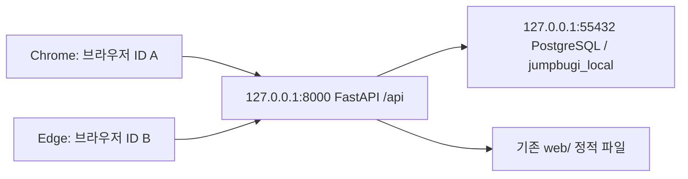
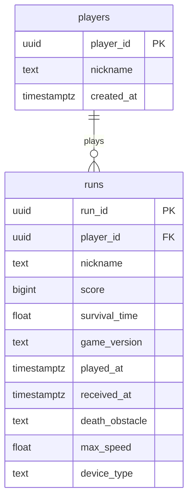

# 로컬 FastAPI·PostgreSQL 개발 기록

상태: **로컬 연결·닉네임 변경·Chrome/Edge·실제 PostgreSQL 보존 검증 완료 (2026-11-26)**. 클라우드 운영·인증·점수 재연산 검증은 후속 범위다.

## 이번 작업 범위

Oracle Cloud 등 클라우드 서버를 만들지 않고 한 PC의 FastAPI와 PostgreSQL을 연결한다. Chrome과 Edge를 같은 로컬 웹 주소로 열어 브라우저별 ID와 플레이 결과가 실제 DB에 들어가는지 검증한다. 사용자가 설계 문서뿐 아니라 로컬 연결 구현까지 승인했다. 기존 Pygame·GitHub Pages·게임 물리/충돌 규칙은 유지한다.

## 확정한 로컬 구조



통합 모드는 `http://127.0.0.1:8000/?server=1`로 명시적으로 선택한다. FastAPI가 기존 `web/`를 같은 출처에서 제공하므로 브라우저는 DB에 직접 접속하지 않는다. 기본 정적 실행·Pages에서는 API 요청을 보내지 않는다. PostgreSQL의 실제 데이터·계정 정보는 Git과 OneDrive 동기화 폴더 밖의 로컬 앱 데이터 영역에 둔다.

기존 `PlayerStore`가 만든 브라우저·프로필·출처별 UUID를 사용한다. Chrome과 Edge는 별도 저장소이므로 다른 ID를 갖는다. 이것은 익명 브라우저 구분이며 로그인·실명 사용자·기기 인증을 뜻하지 않는다. 브라우저 저장소 삭제/시크릿 프로필/주소 변경 시 다른 사용자로 취급될 수 있다.

결과는 기존 브라우저 기록을 먼저 저장하고 비동기로 API에 전송한다. 실패한 신규 결과는 별도 제한 대기열에서 같은 `run_id`로 재시도한다. 이전 로컬 기록 전체를 묵시적으로 업로드하지 않는다. 서버는 UUID·타입·숫자 범위·DB 제약을 검사하고 중복 `run_id`를 처리하지만 게임 재연산에 의한 위변조 검증은 이번 범위가 아니다.

## 재개 지점과 작업 체크

- [x] 사용자 범위 확인: 로컬 FastAPI·PostgreSQL 연결 구현까지 승인
- [x] 기존 app.js·PlayerStore·Pages 경계 확인
- [x] 환경 확인: Python·Node·Chrome·Edge 있음. FastAPI·psycopg·PostgreSQL·Docker는 초기 확인에서 없음
- [x] `server/main.py`·`schema.sql`·의존성·실제 PostgreSQL API 테스트 구현 — 닉네임 검증 포함 최신 14개 통과
- [x] `web/src/api.js`·app.js 비동기 연결·대기열과 Node 테스트 구현 — 닉네임·재등록 검증 포함 최신 45개 통과
- [x] 로컬 PostgreSQL 실행 도구·실제 DB 초기화 — 127.0.0.1:55432, 전용 DB·앱 계정
- [x] 실제 Chrome·Edge 분리 프로필의 저장·재접속·중복 방지 검사
- [x] SQL로 두 브라우저 결과 행을 확인 — 브라우저마다 서로 다른 player_id·run_id, 정확히 1행
- [x] 닉네임 변경 뒤 같은 UUID·기존 로컬 기록/최고점수·과거 DB 결과 보존, 공동 기록판의 현재 이름과 재접속 확인

중단됐다면 먼저 `git status`와 이 문서의 체크를 읽고 현재 파일/실행 프로세스를 확인한다. 기존 변경을 되돌리거나 실제 DB·사용자 기록을 초기화하지 않는다. 원격 반영 등 추가 작업은 해당 요청의 승인 범위를 따르고, 완료 여부는 실제 결과로 기록한다. 비밀번호·연결 문자열은 문서에 기록하지 않는다.

2026-11-26 재개: 직전 Chrome 검사는 자연 충돌과 브라우저 저장까지 진행했으나 서버 행 조회에서 timeout으로 중단됐다. 동기화 객체의 메서드로 호출하던 native fetch를 전역 객체에 바인딩하고 재발 방지 검사를 추가했다. API 재실행 후 실제 Chrome·Edge 저장과 SQL 대조를 완료했다. 2026-11-25의 실패 보고서는 보존했다.

남은 제품 작업은 인증·서버의 점수 신뢰 검증·클라우드 운영 등 [TODO](TODO.md)의 후속 항목이다. 이번 로컬 연결의 미완료 구현은 없다. 이 문서를 읽고 이어갈 때는 이전 체크를 다시 구현하지 말고 `/api/health`·`status`와 최신 검증 보고서를 먼저 확인한다.

## 설치와 실행 — Windows

아래 명령은 게임 프로젝트 `jumpbugi/`에서 실행한다. 이미 준비된 환경에서는 `run`부터 사용한다. Pygame 실행 환경과 서버 가상환경은 독립적이다.

```powershell
# 최초 준비: 프로젝트 전용 Python 환경과 고정된 의존성
python -B -m venv .venv
./.venv/Scripts/python.exe -m pip install -r server/requirements.txt

# 최초 DB 준비: 공식 바이너리 다운로드·SHA256 대조·전용 클러스터/계정/DB 생성
./.venv/Scripts/python.exe -B server/local.py setup

# DB 시작 여부를 확인하고 API 실행: Ctrl+C로 API 종료
./.venv/Scripts/python.exe -B server/local.py run
```

Chrome과 Edge에서 **동일한** `http://127.0.0.1:8000/?server=1`을 연다. API 문서는 `http://127.0.0.1:8000/docs`다. 주소의 `localhost`/`127.0.0.1` 또는 포트를 바꾸면 브라우저 저장 출처가 달라지므로 사용자 ID도 달라질 수 있다. API 포트 충돌 시 `run --port 8001`로 바꾸고 두 브라우저 모두 그 주소를 사용한다. `web/serve.py` 기본 포트도 8000이므로 같은 포트로 함께 실행하지 않는다.

```powershell
# 상태와 저장 요약: 비밀번호를 출력하지 않는다
./.venv/Scripts/python.exe -B server/local.py status
./.venv/Scripts/python.exe -B server/local.py inspect

# API를 먼저 Ctrl+C로 종료한 뒤 DB 종료
./.venv/Scripts/python.exe -B server/local.py stop-db
```

`status`는 PostgreSQL 프로세스 상태다. API 상태는 `/api/health`에서 따로 확인한다. Windows 서비스/자동 시작 등록은 하지 않으며 재부팅 후 `run`이 기존 DB를 다시 시작한다. `setup`은 기존 데이터나 계정 비밀번호를 초기화하지 않는다. 데이터가 있는데 설정이 유실됐거나 주 버전이 다르면 임의 재초기화 대신 중단한다.

공식 PostgreSQL Windows 바이너리는 `server/local.py`에 버전·URL·SHA256을 고정했다. 실제 데이터와 비밀번호는 `%LOCALAPPDATA%/JumpBugi/`에 있으며 저장소나 OneDrive 안에 두지 않는다. API는 `jumpbugi` 앱 계정으로 연결하고 초기 클러스터 관리자와 구분한다. 연결 정보는 실행 프로세스의 `DATABASE_URL`로 전달하며 브라우저·문서·로그에 비밀번호를 넣지 않는다. 기존 PostgreSQL을 별도로 사용할 때는 전용 DB의 `DATABASE_URL`을 주입해 `python -m uvicorn server.main:app --host 127.0.0.1 --port 8000`으로 실행할 수 있다. 자동 마이그레이션/기존 테이블 변경 도구는 없다.

## 코드와 요청 흐름

| 파일 | 현재 책임 |
| --- | --- |
| [main.py](../server/main.py) | `create_app`, Pydantic 입력 검증, API, 요청별 psycopg 연결/트랜잭션, 마지막에 web 정적 파일 제공 |
| [schema.sql](../server/schema.sql) | players·runs 테이블, 제약·인덱스의 비파괴적 최초 생성 |
| [local.py](../server/local.py) | 로컬 바이너리 준비, DB 생명주기, 비밀 연결정보 주입, 실행·검사·저장 요약 |
| [api.js](../web/src/api.js) | `isLocalServerMode`, `LocalServerSync`, 전송 대기열·타임아웃·재시도·공동 랭킹 |
| [app.js](../web/src/app.js) | 기존 `finishRun()` 로컬 저장 후 비동기 전송, 상태·기록판 표시 |
| [storage.js](../web/src/storage.js) | `PlayerStore.setNickname()`의 현재 이름 검증·보관, 기존 UUID·결과·브라우저 최고 기록 유지 |
| [API 테스트](../server/tests/test_api.py) | 별도 임시 스키마에서 실제 PostgreSQL 통합 검사 |
| [브라우저 검증](../tools/verify_local_backend.mjs) | 실제 Chrome·Edge의 격리 프로필, 자연 게임오버, 저장/재접속/중복 검사 |

`finishRun()` → 기존 `PlayerStore.recordRun()` → 신규 결과 대기열 영속화 → 사용자 등록 → 결과 제출 → 커밋 응답 확인 → 대기열 제거 → 공동 랭킹 조회 순서다. 게임 루프는 네트워크 응답을 기다리지 않는다. 응답 유실 시 같은 `run_id`와 원래 payload를 다시 보내며, 서버가 이미 저장했다면 200을 반환한다. 오류 시 UI가 브라우저 기록을 표시하고 재시도 버튼을 제공한다. 대기열이 50개를 넘으면 기존 미전송 기록을 지우지 않고 새 결과를 브라우저 기록에만 남겼다고 안내한다. 저장소가 차단된 경우 전송 대기열은 해당 접속 메모리까지만 유지된다.

### 닉네임과 기록의 이름

닉네임 설정은 현재 브라우저 ID의 표시 이름만 바꾼다. 현재 이름은 앞뒤 공백 정리 후 Unicode 코드 포인트 **2~12자**이며, 원문에 제어·서식·서로게이트·줄 구분 문자(`Cc/Cf/Cs/Zl/Zp`)가 있으면 거절한다. 한글·영문·숫자 외에도 표시 가능한 공백·기호·이모지를 허용하며, 동일한 닉네임을 사용하는 서로 다른 UUID를 합치지 않는다.

로컬에서는 기존 identity의 `nickname`만 저장하고 UUID·과거 결과·브라우저 최고점수를 바꾸지 않는다. 서버 모드에서는 최신 identity로 `POST /api/players`를 보낸 뒤 공동 기록을 다시 조회한다. 이름 변경 중 등록 응답이 늦게 와도 이전 이름을 로컬 현재값으로 되돌리지 않는다. 개인 최고점수 표시는 이 브라우저에 보관한 값이며 서버 공동 기록 전체의 최고값이 아니다. 저장소를 사용할 수 없을 때만 이번 접속 동안의 보관 한계를 안내한다.

`players.nickname`은 현재 이름이고 `runs.nickname`은 제출 당시의 이름이다. `RunInput`의 과거 이름은 기존 **1~40자** 범위를 유지해 이전 대기 결과를 받을 수 있다. `POST /api/runs`는 사용자 이름을 갱신하지 않으며, 중복 비교에도 기존 payload를 그대로 사용한다. 공동 랭킹은 최고 결과를 선택한 뒤 `players`를 조인해 현재 이름을 표시하고, 사용자 결과 조회는 과거 이름을 반환한다. API 경로·DB 스키마 변경이나 기존 기록의 일괄 변환은 없다.

## API 계약

모든 경로는 같은 출처의 `/api` 아래다. `players`와 `runs`의 ID는 UUID다.

| 요청 | 입력/조회 | 성공·실패 |
| --- | --- | --- |
| `GET /api/health` | 실제 DB `SELECT 1` | 연결 성공 200, DB 미설정/실패 503 |
| `POST /api/players` | `player_id`, 현재 `nickname` 2~12자 | 신규 201, 같은 ID 재등록/닉네임 갱신 200 |
| `POST /api/runs` | 아래 한 판 결과 | 신규 201, 같은 ID·같은 내용 200, 같은 ID·다른 내용/소유자 409, 미등록 사용자 404 |
| `GET /api/runs?player_id=...&limit=50` | 해당 ID의 기록, limit 1~50 | `{items: [...]}`, 최신 played_at 순 |
| `GET /api/leaderboard?limit=5` | limit 1~100 | `{items: [...]}`, 사용자마다 최고 한 판씩 |

한 판 입력은 기존 로컬 기록과 같은 `player_id`, `nickname`, `run_id`, `score`, `survival_time`, `game_version`, `played_at`, `death_obstacle`, `max_speed`, `device_type`이다. 이때 `nickname`은 현재 이름 변경 입력과 다른 과거 결과의 1~40자 필드다. `played_at`은 시간대를 포함한 클라이언트 시각, `received_at`은 DB가 기록하는 수신 시각이다. 점수는 0~JavaScript 안전 정수 상한, 시간/속도는 유한한 비음수와 코드의 상한 범위다. 문자열 길이, 필수값·추가 필드·기기 구분을 검사한다. 잘못된 입력은 422이며 DB 오류 응답에 연결정보를 노출하지 않는다.

공동 랭킹은 점수 내림차순 → 생존시간 내림차순 → 플레이시각 오름차순 → run_id 오름차순으로 결정한다. 한 사용자의 여러 판 중 같은 기준의 최고 한 판만 선택한다. ID별 조회는 현재 인증/권한 검사 기능이 아니며, 가명 ID를 아는 로컬 호출자는 그 ID로 요청할 수 있다. 외부 공개 서비스로 사용하는 단계에는 별도 인증·접근 제어·속도 제한·배포/보안 설계가 필요하다.

## PostgreSQL 데이터 모델



`players.nickname`은 현재 표시 이름, `runs.nickname`은 제출 당시 이름이다. `run_id` 기본키가 중복 저장을 막고 `player_id` 외래키가 미등록 ID를 거절한다. 닉네임 변경에서도 UUID와 등록 시각·기존 결과 행을 보존한다. 모든 값은 SQL 매개변수로 전달한다. 요청마다 연결을 열어 성공 시 커밋·실패 시 롤백·종료 시 닫는다. 초기 스키마는 `CREATE ... IF NOT EXISTS`이며 기존 데이터를 삭제하지 않는다. 완성된 스키마 이행·백업/복원 운영 체계는 별도 후속 작업이다.

## 반복 검증 절차

```powershell
# 실제 PostgreSQL: 테스트가 만든 UUID 스키마만 생성·정리
./.venv/Scripts/python.exe -B server/local.py test

# 웹 테스트: web/에서 실행
node --test tests/*.test.js

# API 실행 후 jumpbugi/에서 실제 두 브라우저 확인
node tools/verify_local_backend.mjs "http://127.0.0.1:8000/?server=1"

# 위 명령이 출력한 실제 report.json 경로를 사용해 직접 SQL 교차 확인
./.venv/Scripts/python.exe -B server/local.py verify-report --report web/.qa/local-backend/<실행ID>/report.json
```

마지막 검사는 사용자 기본 프로필 대신 `web/.qa/local-backend/<실행ID>/`의 새 격리 프로필을 사용한다. 실제 시작 클릭과 자연 충돌로 판을 끝내고, 각 브라우저의 서로 다른 ID·한 판 결과·서버 저장 응답·동일 프로필 재접속·동일 결과 재전송의 중복 방지를 확인한다. 실패 보고서에는 서버 상태와 대기열·API 응답·스크린샷을 기록한다. 이어서 보고서의 `player_id`·`run_id`로 DB를 직접 조회해야 API 응답과 실제 PostgreSQL 저장을 교차 확인할 수 있다. 이전 사용자 데이터나 기본 브라우저 저장소는 초기화하지 않는다.

## 2026-11-26 닉네임 변경 검증

- 실제 PostgreSQL API 검사 **14개 통과**, 3.997초. 현재 이름 검증·UUID/등록 시각/결과 행 보존·같은 이름의 두 ID·과거 40자 대기 결과·현재 이름을 되돌리지 않는 중복 제출을 포함한다.
- Node 검사 **45개 통과**, 133.3963ms. 현재 이름 저장·Unicode 경계·저장소 차단·등록 응답과 이름 변경의 순서·기존 대기 payload 보존을 확인했다.
- 실제 **Chrome 157·Edge 158**의 격리 프로필에서 자연 게임오버 후 이름을 `검증부기`로 변경했다. UUID·run_id·로컬 결과 배열과 브라우저 최고값이 그대로였고 현재 이름이 재접속 후에도 유지됐다. PC·모바일 모사의 입력 영역과 기록판 배치도 확인했다.
- 실제 UI에 입력한 `<b>부기</b>`는 HTML 요소가 아닌 문자 그대로 표시됐고, 취소는 POST 요청이나 identity 변경을 만들지 않았다. 서버 선택 없는 기본 모드의 기존 Chrome PC/모바일 모사 **8개 검사 묶음도 통과**했다.
- **직접 SQL 대조 통과**. 두 사용자의 현재 `players.nickname`은 `검증부기`, 기존 `runs.nickname`은 각각 `JumpBugi_523`·`JumpBugi_839`으로 남았고 같은 UUID/run_id의 결과가 정확히 1행씩 있었다. 공동 기록판은 현재 이름을 표시했다.
- 이미 저장된 과거 payload를 QA 대기열에 다시 넣어 응답 유실 후 재시도를 모사했다. 이름·점수·행 수가 변하지 않았다. 이는 의도적으로 만든 QA 조건이며 실제 PostgreSQL 중단이나 실제 응답 유실을 재현한 검사는 아니다.

산출물은 `web/.qa/local-backend/1795698732513-45024/report.json`과 같은 폴더의 `database-report.json`이다. 생성물은 Git 제외 대상이다. headless 실제 브라우저·모바일 화면 모사 결과이며 실물 휴대폰 체감이나 공개 서버 운영을 검증한 결과는 아니다.

## 2026-11-26 로컬 연결 최초 검증 결과

- API 통합 검사 **9개 통과**, 3.138초. 테스트 전용 스키마를 사용하고 실제 앱 테이블을 지우지 않았다. 설치된 Starlette의 httpx TestClient 폐기 예정 경고는 있으나 검사 실패는 없었다.
- 웹 검사 **34개 통과**, 231.535ms. 기존 엔진/저장소 21개와 새 전송·재시도·원래 fetch 수신 객체 검사 13개를 포함한다.
- 실제 Chrome **157.0.8103.79**, Edge **158.0.4370.33**의 새 격리 프로필로 자연 게임오버·등록·서버 저장·공동 랭킹·재접속을 확인했다. 각각 player_id와 run_id가 달랐고 `saved`, 미전송 0개, 브라우저 오류 없음이었다.
- 같은 결과 재전송은 200이며 행 수가 늘지 않았고, 같은 run_id로 내용 변경은 409, 음수 점수는 422였다.
- `verify-report`의 **직접 SQL 대조 통과**. 두 결과 모두 players와 연결된 runs 행이 정확히 1개였고 점수·생존시간 등 제출 값과 일치했다.
- 서버 선택 없는 기본 `/` 모드의 기존 Chrome PC/모바일 모사 8개 검사 묶음도 통과했다. 이번 범위 문서 17개의 상대 링크 199개·앵커 14개, 보호 대상 추적 파일 212개와 Git diff 형식 검사를 확인했다. 변경하지 않은 Python·웹 학습 본문과 보관 문서는 이번 링크 검사 대상에서 제외했다.

검증 산출물은 `web/.qa/local-backend/1795693405286-27332/report.json`과 같은 디렉터리의 `database-report.json`에 있다. 이 파일들은 생성물로 Git에서 제외된다. 아래 ID는 격리 검사에서 생성한 가명 데이터다.

| 브라우저 | player_id | run_id | 직접 SQL 행 수 |
| --- | --- | --- | --- |
| Chrome | `2fa519d1-8bd9-4d30-89dd-2e10ea8c3e41` | `105d26df-612a-4caa-b8a3-67b777431709` | 1 |
| Edge | `6c939879-bd03-4bc4-92d2-ae84529e3d2b` | `23bc4428-8572-4ef4-b298-51e1bdebcdb8` | 1 |

로컬 데이터는 이후 직접 플레이에도 사용할 수 있게 보존했다. 두 브라우저를 headless로 구동한 검사이며 사람의 실기 조작감·외부 인터넷 접속·클라우드 배포를 확인한 결과는 아니다.

## 기술 근거

현재 설계 확인에 사용한 공식 자료: [FastAPI 정적 파일](https://fastapi.tiangolo.com/tutorial/static-files/), [psycopg SQL 매개변수](https://www.psycopg.org/psycopg3/docs/basic/params.html), [트랜잭션](https://www.psycopg.org/psycopg3/docs/basic/transactions.html), [PostgreSQL Windows 배포](https://www.postgresql.org/download/windows/).
