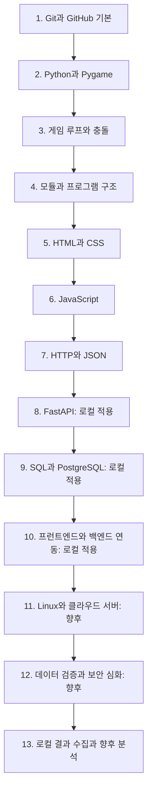

# 점프부기 기술 학습 로드맵

작성 기준: **2026-11-26**, 현재 `desktop_prototype/`·`web/`·`server/`·테스트·배포 설정. 이 문서는 학습 순서와 독립 실습의 기준을 정합니다. Python/Pygame의 자세한 해설은 [STUDY_NOTES](STUDY_NOTES.md), 웹의 자세한 해설은 [WEB_STUDY](WEB_STUDY.md), 실제 시스템 관계는 [ARCHITECTURE](ARCHITECTURE.md), 로컬 API·DB 실행은 [BACKEND](BACKEND.md)를 함께 읽습니다.

## 적용 상태와 공부하는 방법

현재 적용된 기술은 Python/Pygame, HTML/CSS, JavaScript, 게임 루프·마스크 충돌, 모듈 분리, 파일·브라우저 저장, HTTP/JSON, Git/GitHub와 GitHub Pages 배포입니다. 별도 로컬 서버 모드에는 FastAPI·PostgreSQL·종료 결과 제출·사용자별 최고 기록·재시도도 적용했습니다. **클라우드·Linux 서버 운영, 계정 인증, 점수 위변조 검증과 분석 파이프라인**은 향후 학습 및 개발 대상입니다. Pages 배포는 기존 정적 게임이며 로컬 API·DB를 호스팅하지 않습니다. 구현된 코드의 학습과 실제 실행 검증 결과는 구분하고, 결과는 CHANGELOG의 해당 날짜를 확인합니다.

각 단계는 **읽기 → 값과 결과 예측 → 독립 실습 → 기존 코드와 비교 → 자기 말로 설명**하는 순서로 진행합니다. 통과 기준을 충족하면 다음 단계로 넘어가고, 필요한 개념은 다시 돌아와 공부합니다. Git으로 변경을 확인하는 습관과 민감정보·입력값·실제 기록을 보호하는 원칙은 모든 단계에 적용합니다.

실습 공간은 저장소의 기존 [study/](../../study/)입니다. 이 프로젝트 폴더에서는 `../study/`에 해당합니다. 기존 `game01.py`~`game08.py`와 `prototype_game.py`는 과거 학습 자료로 보존하며 현재 게임의 진입점으로 사용하지 않습니다. 오래된 코드의 실행 가능성은 별도로 확인해야 합니다. 앞으로 기술별 독립 실습이 필요할 때 `study/python/`, `study/web/`, `study/http/`, `study/sql/` 같은 구성을 선택할 수 있으나 이번 정리에서 폴더·실습 코드 생성이나 과거 파일 이동은 수행하지 않습니다.

아래 과제는 앞으로 직접 수행할 학습 과제입니다. 실제 게임 소스, `txt/high_score.txt`, 현재 브라우저 기록을 변경하거나 지울 필요가 없습니다. 저장 실습은 임시 파일·가짜 저장소·별도 출처를 사용하고, DB 실습은 합성 데이터만 사용합니다. API 키·비밀번호·인증 파일은 실습 결과물이나 Git에 넣지 않습니다.

## 권장 순서



보안 기본은 1단계부터 적용하고 12단계에서 서버의 신뢰 경계를 다룹니다. HTML/CSS를 이미 알고 있다면 웹 학습을 먼저 시작할 수 있지만, 두 게임의 규칙을 비교하기 전에는 3·4단계의 시간·상태·의존 관계를 확인합니다.

## 1. Git 및 GitHub

| 항목 | 학습 내용 |
| --- | --- |
| 학습 목적 | 현재 변경 범위와 프로젝트/저장소 경계를 확인하고 검토 가능한 변경을 만든다. |
| 선행 지식 | 파일·폴더·상대 경로, 터미널의 현재 작업 디렉터리. |
| 핵심 개념 | 작업 트리, 추적/미추적/무시 파일, diff, 브랜치, 커밋, 원격 저장소, PR, Actions, 정적 배포. |
| 관련 파일·함수 | 상위 저장소의 [.gitignore](../../.gitignore), 프로젝트 [.gitignore](../.gitignore), [web/.gitignore](../web/.gitignore), [deploy.yml](../../.github/workflows/deploy.yml). Git 설정이므로 게임 함수는 없다. |
| 실제 적용 방식·상태 | 현재 Git 루트는 프로젝트의 상위 폴더다. Pages 워크플로가 `jumpbugi/web`을 정적 산출물로 배포한다. 게임 실행과 원격 저장소 반영은 별개다. |
| 권장 분석 순서 | `git rev-parse --show-toplevel` → `git status --short` → 세 gitignore → 배포 워크플로의 경로 → `git diff`. |
| 독립 실습 과제 | 별도 연습 저장소에서 파일 수정·무시·diff·브랜치 작업을 해 보고 커밋 전 검토 항목을 적는다. 이 프로젝트의 커밋·push는 별도 요청이 있을 때 수행한다. |
| 학습 완료 판단 기준 | 소스 변경과 생성물을 구분하고, 어떤 파일이 배포되는지 설명하며, 의도하지 않은 변경을 diff에서 찾는다. |

## 2. Python 및 Pygame

| 항목 | 학습 내용 |
| --- | --- |
| 학습 목적 | 객체의 상태와 Pygame 입력·화면·종료를 연결해 데스크톱 게임을 읽는다. |
| 선행 지식 | 변수, 조건문, 반복문, 함수, 목록·딕셔너리, 기본 클래스 문법. |
| 핵심 개념 | 모듈/패키지, `self`, 객체 소유 관계, 이벤트, Surface, Rect, 좌표, 파일 경로, 자원 준비와 반복 처리. |
| 관련 파일·함수 | [config.py](../desktop_prototype/config.py), [main.py](../desktop_prototype/main.py)의 `main`, `JumpBugi.__init__/handle_events/run`, [frontend.py](../desktop_prototype/frontend.py)의 `GameView`, [backend.py](../desktop_prototype/backend.py)의 `GameState`. |
| 실제 적용 방식·상태 | 현재 `main()`이 `JumpBugi`를 만들고, view가 준비한 이미지 크기·마스크를 state에 전달한다. 이벤트 처리·상태 갱신·화면 출력이 메인 루프에서 이어진다. |
| 권장 분석 순서 | STUDY_NOTES의 객체·시작 장 → config → `JumpBugi.__init__` → `run/handle_events` → `GameState.jump` → `GameView` 출력. |
| 독립 실습 과제 | 새 실습 파일에서 작은 창에 사각형을 그리고 키 입력으로 이동시키며 QUIT 이벤트로 정상 종료한다. 게임 이미지나 최고점수는 사용하지 않는다. |
| 학습 완료 판단 기준 | `self.state`와 `self.view`의 소유자, 초기화 한 번과 반복 호출의 차이, 입력에서 화면 변화까지의 호출 순서를 설명한다. |

## 3. 게임 루프 및 충돌 판정

| 항목 | 학습 내용 |
| --- | --- |
| 학습 목적 | 프레임 수·경과 시간·물리 계산을 구분하고 표시와 충돌의 관계를 검증한다. |
| 선행 지식 | 2단계, 위치/속도/시간의 단위, 기본 비율 계산. |
| 핵심 개념 | FPS, `dt`, 물리 step, 중력·속도 적분, 정지/게임오버 상태, Rect 후보 검사, 알파 마스크와 상대 좌표, 경계 조건. |
| 관련 파일·함수 | [backend.py](../desktop_prototype/backend.py)의 `update/update_step/collides_with_obstacle/award_pass_bonuses`, [assets.py](../desktop_prototype/assets.py)의 `collision_mask`, [engine.js](../web/src/engine.js)의 `GameEngine.update/updateStep/collides`와 `masksOverlap`, [test_collision.py](../tests/test_collision.py), [engine.test.js](../web/tests/engine.test.js). |
| 실제 적용 방식·상태 | 두 버전 모두 시간차로 상태를 갱신하며 표시 포즈에 대응하는 마스크를 사용한다. 긴 프레임 지연에서는 경과 시간 전체와 최대 0.1초로 제한된 이동 계산이 달라질 수 있다. |
| 권장 분석 순서 | `JumpBugi.run`과 웹 `frame` → 각 엔진의 update → update_step/updateStep → 충돌 함수 → 프레임/마스크 준비 → 기존 시간·충돌 테스트. |
| 독립 실습 과제 | 그림 없는 점프 계산으로 30·60·120회/초 갱신을 비교하고, 작은 0/1 격자 두 개의 겹침을 손계산과 코드로 비교한다. |
| 학습 완료 판단 기준 | 같은 생존 시간과 같은 물리 결과가 항상 일치하지 않는 이유, 투명 부분의 비충돌, 정지·중복 점수 방지 조건을 사례로 설명한다. |

## 4. 모듈화와 프로그램 구조 설계

| 항목 | 학습 내용 |
| --- | --- |
| 학습 목적 | 현재 파일의 책임과 데이터 전달을 이해하고 변경할 파일을 근거 있게 선택한다. |
| 선행 지식 | 2·3단계, 함수 인자/반환값/부수 효과, import. |
| 핵심 개념 | 진입점, 의존 방향, 상태 소유, 계산과 화면/저장 경계, 순환 의존, 공개 함수·클래스. |
| 관련 파일·함수 | [patterns.py](../desktop_prototype/patterns.py)의 `PatternUnlocks/choose_pattern`, [obstacles.py](../desktop_prototype/obstacles.py)의 `GreetingJump/SjMember/frame_index`, [season.py](../desktop_prototype/season.py)의 `SeasonProgress/background_transition`, [difficulty.py](../desktop_prototype/difficulty.py)의 `profile_for_slot`, [storage.py](../desktop_prototype/storage.py)의 `load_high_score/save_high_score`. |
| 실제 적용 방식·상태 | Python의 GameState가 계산 모듈과 저장을 연결하고 GameView가 자원을 받아 그린다. 웹은 app·engine·storage의 기존 역할을 유지하고 선택적 통신을 api.js에 둔다. `backend.py`는 같은 프로세스의 게임 규칙 담당이며 HTTP 백엔드가 아니다. |
| 권장 분석 순서 | ARCHITECTURE 호출도 → main의 생성자 인자 → backend의 import/위임 함수 → 계산 모듈 → storage → 웹 app/engine/storage와 api 경계. |
| 독립 실습 과제 | 게임 소스를 바꾸지 않고 점프·장애물 선택·최고점수 저장의 호출도와 입력/출력/부수 효과 표를 작성한다. 별도 study 실습에서 점수 계산만 하는 순수 함수 모듈과 이를 호출하는 CLI 모듈을 구현하고, 계산 모듈이 입력·파일 저장에 의존하지 않도록 구성한다. |
| 학습 완료 판단 기준 | 기능 요구 하나에 필요한 기존 파일과 검증 방법을 설명하고, 파일을 추가로 쪼개지 않아도 현재 책임을 추적한다. |

## 5. HTML 및 CSS

| 항목 | 학습 내용 |
| --- | --- |
| 학습 목적 | 웹페이지 구조와 게임 논리 화면을 구분하고 반응형 배치를 읽는다. |
| 선행 지식 | 파일 경로, 브라우저 개발자 도구의 요소 확인, 기본 좌표·크기. |
| 핵심 개념 | HTML 요소, DOM, id/class, CSS 선택자, 크기/여백, Grid/Flex, 미디어 쿼리, Canvas와 HTML UI의 차이. |
| 관련 파일·함수 | [index.html](../web/index.html), [style.css](../web/style.css), [app.js](../web/src/app.js)의 `syncCanvasResolution`, `refreshUI`, `renderLeaderboard`. |
| 실제 적용 방식·상태 | 현재 HTML은 Canvas·조작·SCORE/TIME·기록판을 제공하고 CSS가 PC 두 열/좁은 화면 한 열을 정한다. 웹 논리 화면은 640×360이며 CSS 확대가 물리 규칙을 바꾸지 않는다. |
| 권장 분석 순서 | WEB_STUDY의 화면 구성 장 → HTML의 게임/HUD/기록판 → CSS의 바깥 배치·크기·미디어 쿼리 → `syncCanvasResolution`. |
| 독립 실습 과제 | 별도 HTML/CSS에서 가짜 게임 영역과 합성 기록판을 만들고 넓은 화면/좁은 화면의 배치를 전환한다. |
| 학습 완료 판단 기준 | DOM과 Canvas 내부 그림을 구분하고, 배치를 바꿀 위치와 논리 좌표를 바꿀 위치를 각각 찾는다. |

## 6. JavaScript

| 항목 | 학습 내용 |
| --- | --- |
| 학습 목적 | 브라우저 입력에서 엔진 상태·그리기·결과 저장까지 직접 추적한다. |
| 선행 지식 | 5단계, 조건문·반복문·함수·객체의 기본 개념. |
| 핵심 개념 | ES 모듈, 객체/배열, 클래스, 이벤트 콜백, `requestAnimationFrame`, 비동기 함수, Promise, DOM 갱신, localStorage. |
| 관련 파일·함수 | [app.js](../web/src/app.js)의 `load/start/jump/frame/draw/finishRun`, [engine.js](../web/src/engine.js)의 `GameEngine.jump/update`, [storage.js](../web/src/storage.js)의 `PlayerStore.recordRun/leaderboard`. |
| 실제 적용 방식·상태 | app이 자산·입력·화면 단계와 저장 연결을 맡고 engine이 게임 규칙을 계산한다. 게임오버 결과는 한 판에 한 번 PlayerStore에 전달되며 선택한 로컬 서버 모드만 api.js 전송을 추가한다. Python 게임을 브라우저에서 직접 실행하는 구조가 아니다. |
| 권장 분석 순서 | WEB_STUDY의 작은 문법 사전 → `load` → 시작/키 입력 → `GameEngine.jump` → `frame/update/draw` → `finishRun/recordRun`. |
| 독립 실습 과제 | 별도 ES 모듈 두 개로 입력 카운터와 메모리 기록판을 만들고 이벤트 한 번에 기록 하나가 생기는지 확인한다. |
| 학습 완료 판단 기준 | Space 입력부터 착지까지의 함수·변수 변화와 게임오버 저장 경로를 코드 없이 설명하고, 비동기 자산 준비가 끝나야 하는 이유를 말한다. |

## 7. HTTP 및 JSON

| 항목 | 학습 내용 |
| --- | --- |
| 학습 목적 | 정적 자산 전달과 실제 API 요청을 구분하고 JSON을 안전하게 읽는다. |
| 선행 지식 | 6단계, URL, 객체/배열, 비동기 처리, 직렬화의 기초. |
| 핵심 개념 | 요청/응답, 메서드, 상태 코드, 헤더, 출처, JSON 파싱/직렬화, 네트워크 실패와 데이터 형식 오류의 차이. |
| 관련 파일·함수 | [serve.py](../web/serve.py)의 `WebHandler`, [app.js](../web/src/app.js)의 `load`, [storage.js](../web/src/storage.js)의 `PlayerStore.read/write`, [api.js](../web/src/api.js)의 `LocalServerSync.request`, [main.py](../server/main.py)의 API 응답. |
| 실제 적용 방식·상태 | HTTP로 정적 manifest·PNG를 읽으며 서버 모드에서는 같은 출처에 JSON 결과를 POST하고 공동 기록을 GET한다. 정적 모드에서는 API 요청을 하지 않는다. |
| 권장 분석 순서 | serve의 제공 루트 → `load`의 manifest 응답 → PlayerStore JSON 처리 → `LocalServerSync.request` → API 상태 코드·타임아웃 처리. |
| 독립 실습 과제 | 별도 정적 서버에서 작은 JSON을 읽고 정상 응답·없는 파일·잘못된 JSON을 구분해 표시한다. 외부 서비스나 API 키는 사용하지 않는다. |
| 학습 완료 판단 기준 | HTTP 성공과 JSON 형식 성공을 구분하며, 로컬 저장·정적 JSON 다운로드·서버 점수 제출을 서로 다른 동작으로 설명한다. |

## 8. FastAPI — 로컬 적용

| 항목 | 학습 내용 |
| --- | --- |
| 학습 목적 | 실제 로컬 API의 요청 검증·응답·DB 연결과 게임 루프의 경계를 이해한다. |
| 선행 지식 | Python 함수·타입 표현, 7단계의 HTTP/JSON, 예외와 입력값 검증. |
| 핵심 개념 | 라우트, 요청/응답 모델, 필수 필드, 상태 코드, 오류 응답, 의존성, API 자동 문서. |
| 관련 파일·함수 | [main.py](../server/main.py)의 `create_app`, `PlayerInput/RunInput`, `register_player/record_run/list_runs/leaderboard/health`, [local.py](../server/local.py)의 `main`, [API 통합 검사](../server/tests/test_api.py). |
| 실제 적용 방식·상태 | 로컬 FastAPI가 같은 출처의 정적 게임·등록·결과 저장/조회·랭킹을 제공한다. `web/serve.py`는 별도 정적 서버다. 클라우드·인증·점수 진위 검증은 아직 없다. |
| 권장 분석 순서 | 현재 결과 필드 → `create_app`와 라우트 → 입력 모델 → DB 연결/lifespan → 오류 응답 → 실제 PG 통합 검사의 성공·실패 사례. |
| 독립 실습 과제 | study의 별도 앱에서 메모리에 합성 점수 하나를 받거나 조회하는 API를 만들고 필드 누락·음수·잘못된 타입 응답을 비교한다. 기존 게임·DB에는 연결하지 않는다. |
| 학습 완료 판단 기준 | 요청 모델과 점수 진위 검증을 구분하고 201·200·404·409·422·503의 발생 조건과 요청별 저장 트랜잭션을 설명한다. |

## 9. SQL 및 PostgreSQL — 로컬 적용

| 항목 | 학습 내용 |
| --- | --- |
| 학습 목적 | 플레이 결과를 관계형 데이터로 모델링하고 조회·집계·보존을 이해한다. |
| 선행 지식 | 표·행·열, 8단계의 데이터 필드/검증, 저장과 조회의 구분. |
| 핵심 개념 | 기본키/외래키, 제약조건, SELECT/INSERT, JOIN, GROUP BY, 정렬, 인덱스, 트랜잭션, 연결 정보 관리. |
| 관련 파일·함수 | [schema.sql](../server/schema.sql)의 `players/runs`·제약·인덱스, [main.py](../server/main.py)의 `database/record_run/leaderboard`, [local.py](../server/local.py)의 `setup/connection_info`. |
| 실제 적용 방식·상태 | 로컬 PostgreSQL에 UUID 사용자와 완료 결과를 저장하고 SQL로 사용자별 최고 결과를 조회한다. Pygame TXT·브라우저 결과와 별개다. 초기화 SQL은 기존 테이블 변경을 관리하는 마이그레이션 체계가 아니다. |
| 권장 분석 순서 | 웹 결과 객체 → schema의 키·제약 → INSERT/중복 처리 → 개인 기록 SELECT → 사용자별 최고 결과 SQL → 인덱스·트랜잭션 → 임시 스키마 검사. |
| 독립 실습 과제 | 별도 실습 DB에 합성 플레이어·결과를 넣고 최고점수·평균 생존시간을 조회한다. 중복 키와 존재하지 않는 플레이어 참조를 시도해 제약을 관찰한다. |
| 학습 완료 판단 기준 | 같은 결과를 중복 저장하지 않을 기준과 키 관계를 설명하고, 요구한 랭킹/집계를 SQL로 작성하며 접속 비밀번호를 저장소에 남기지 않는다. |

## 10. 프런트엔드와 백엔드 연동 — 로컬 적용

| 항목 | 학습 내용 |
| --- | --- |
| 학습 목적 | 로컬 한 판 결과를 서버와 주고받는 흐름과 실패 시 동작을 설계한다. |
| 선행 지식 | 6~9단계, 비동기 처리, 서버 입력 검증, 데이터 저장/조회. |
| 핵심 개념 | API 계약, 제출/조회, 로딩/실패 UI, 출처와 CORS, 중복 요청, 재시도, 버전, 로컬 기록과 서버 기록의 구분. |
| 관련 파일·함수 | [app.js](../web/src/app.js)의 `finishRun/renderLeaderboard`, [api.js](../web/src/api.js)의 `isLocalServerMode`와 `LocalServerSync.submit/retry/flush/request`, [main.py](../server/main.py), [브라우저 검증 도구](../tools/verify_local_backend.mjs). |
| 실제 적용 방식·상태 | 기본 모드는 로컬 결과만 저장한다. loopback의 `?server=1`은 로컬 결과 → 미전송 대기열 → 같은 출처 API → PG → 공동 기록 조회를 추가한다. 실패 시 로컬 저장과 재시도를 유지한다. |
| 권장 분석 순서 | `finishRun/recordRun` → 모드 판별 → 대기열 저장 → `retry/flush` → API 중복 처리 → 공동 기록 DOM → 실패·시간 초과·재접속. |
| 독립 실습 과제 | 별도 웹 페이지와 실습 API로 합성 결과를 제출·조회한다. 서버 중단·같은 요청 재전송·검증 실패를 관찰하고 각 기대 동작을 적는다. |
| 학습 완료 판단 기준 | 브라우저·API·DB 순서도를 그리고 성공/실패/중복 상황을 재현하며, 브라우저 ID를 인증된 사용자로 취급하지 않는다. |

## 11. Linux 및 클라우드 서버 — 향후 서버 운영

| 항목 | 학습 내용 |
| --- | --- |
| 학습 목적 | 정적 배포와 API/DB 서버 운영의 차이를 이해하고 작은 서비스를 실행·관찰한다. |
| 선행 지식 | 1단계의 Git/Actions, 7~10단계, 터미널·프로세스·파일 경로 기초. |
| 핵심 개념 | 사용자/권한, 프로세스, 포트, 환경변수, 로그, 서비스 재시작, HTTPS, 프록시, 방화벽, 백업과 복원. |
| 관련 파일·함수 | 현재 비교 자료는 [deploy.yml](../../.github/workflows/deploy.yml), [local.py](../server/local.py)의 Windows DB 준비·`run` 실행, [server README](../server/README.md). 현재 Linux API 서비스·클라우드 DB 운영 설정은 없다. |
| 실제 적용 방식·상태 | Pages 정적 배포와 Windows loopback API·DB 실행은 현재 적용했다. FastAPI·PostgreSQL의 Linux/클라우드 운영은 향후 단계이며 플랫폼·도메인·서비스 구성을 확정하지 않았다. |
| 권장 분석 순서 | Pages 산출물과 경로 → 로컬 정적 서버 → 실습 API 프로세스/포트 → Linux 파일 권한·환경변수·로그 → 종료/재시작 → 배포·복구 계획. |
| 독립 실습 과제 | 로컬 Linux VM 등 별도 환경에서 실습 정적 서버/API를 실행하고 프로세스·포트·로그를 확인한 뒤 정상 종료·재시작한다. 유료 인프라 생성이나 공개 배포는 별도 결정한다. |
| 학습 완료 판단 기준 | 정적 파일과 실행 중인 API의 책임을 구분하고, 오류 로그를 찾으며, 비밀값 주입·종료·재시작·데이터 복구 절차를 설명한다. |

## 12. 데이터 검증 및 보안 — 현재 형식 검증과 향후 신뢰 검증

| 항목 | 학습 내용 |
| --- | --- |
| 학습 목적 | 데이터 형식 검증과 점수의 진위 확인을 구분하고 서버의 신뢰 경계를 설계한다. |
| 선행 지식 | 모든 단계의 민감정보 보호 원칙, 7~10단계, 게임의 점수·시간·상태 규칙. |
| 핵심 개념 | 타입/범위/필수값 검증, 클라이언트 변경 가능성, 인증/인가, 입력 크기·빈도 제한, 중복/재전송, 로그·개인정보 최소화, 서버 검증의 한계. |
| 관련 파일·함수 | [storage.js](../web/src/storage.js)의 `validIdentity/validResult`, [main.py](../server/main.py)의 `InputModel/RunInput/record_run`, [schema.sql](../server/schema.sql)의 제약, [API 검사](../server/tests/test_api.py), [engine.js](../web/src/engine.js)의 득점 처리. |
| 실제 적용 방식·상태 | 브라우저·Pydantic·DB가 타입/범위를 검사하고 같은 run_id의 중복·충돌을 처리한다. 현재는 인증·인가나 점수 위변조 검증이 아니며 클라이언트 요약을 저장한다. |
| 권장 분석 순서 | 득점 생성 위치 → 브라우저 형식 → RunInput 검증 → DB 제약 → 동일/다른 내용 재전송 → 사용자가 바꿀 수 있는 값과 검증 한계. |
| 독립 실습 과제 | 가짜 저장소와 실습 API에 음수·매우 큰 값·필드 누락·중복 run_id를 넣어 형식/정책/게임 증거 검증을 구분하는 표를 만든다. 실제 브라우저 기록은 수정하지 않는다. |
| 학습 완료 판단 기준 | UUID·닉네임·정상 JSON만으로 신뢰할 수 없는 이유를 설명하고, 서버가 거절할 조건과 아직 판단할 수 없는 조작을 구분한다. |

## 13. 데이터 수집 및 분석 — 로컬 요약 수집과 향후 분석

| 항목 | 학습 내용 |
| --- | --- |
| 학습 목적 | 게임 개선 질문에서 필요한 최소 데이터와 분석 방법을 정한다. |
| 선행 지식 | 현재 기록 필드, 9단계의 SQL 집계, 12단계의 검증·개인정보 원칙, 평균/분포/표본의 기초. |
| 핵심 개념 | 수집 목적, 데이터 사전, 버전/시각/단위, 누락·중복, 표본 편향, 집계·분포, 보존/삭제 범위, 재현 가능한 분석. |
| 관련 파일·함수 | [app.js](../web/src/app.js)의 `finishRun`, [api.js](../web/src/api.js)의 제출, [schema.sql](../server/schema.sql)의 `runs`, [main.py](../server/main.py)의 조회, [GAME_IDEA의 분석 확장](GAME_IDEA.md#7-데이터-분석-확장), [DIFFICULTY_REPORT.json](DIFFICULTY_REPORT.json). |
| 실제 적용 방식·상태 | 서버 모드만 완료한 판의 요약을 로컬 PG에 저장한다. 공개 사용자 수집·분석 파이프라인은 없다. 난이도 보고서는 자동 입력 검사 자료이며, 아이디어의 season/weather/location 등은 현재 저장 필드가 아니다. |
| 권장 분석 순서 | 개선 질문 하나 → 현재 결과 필드 확인 → 필요한 값/단위/수집 여부 표 → 합성 데이터 정제 → SQL/간단한 분석 → 해석의 한계. |
| 독립 실습 과제 | 합성 JSON/CSV로 점수·생존시간 분포와 장애물별 결과를 집계한다. 중복·누락·게임 버전 차이가 결과에 주는 영향을 비교한다. |
| 학습 완료 판단 기준 | 분석 질문에 필요한 최소 필드를 설명하고, 자동 검사/합성 데이터/실제 사용자 데이터를 구분하며, 표본만으로 전체 난이도를 단정하지 않는다. |

## 학습 기록과 다음 개발 단계

한 번 공부한 뒤 다음 형식으로 자기 설명을 남깁니다. Python 개념은 STUDY_NOTES, 웹 개념은 WEB_STUDY의 해당 장을 활용하고, 이 로드맵에는 진행 판단 기준만 관리합니다. 실제 코드 변경 계획은 [TODO](TODO.md), 실제 완료 및 검증은 [CHANGELOG](CHANGELOG.md)에 기록합니다.

```text
기술/질문:
읽은 실제 파일과 함수:
예상한 입력·상태·결과:
독립 실습 조건과 관찰 결과:
내 말로 설명한 동작과 이유:
아직 설명하지 못하는 부분:
완료 기준 충족 여부와 근거:
```

현재 로컬 백엔드는 BACKEND·ARCHITECTURE·server README에서 설명합니다. 공개 API·DB 변경 관리·보안·클라우드 운영의 범위가 정해질 때 필요한 API·DATABASE·SECURITY·DEPLOYMENT 문서를 추가합니다. 학습을 위한 독립 실습, 현재 제품에 반영된 코드와 실제 실행 검증은 각각 구분해 기록합니다.
